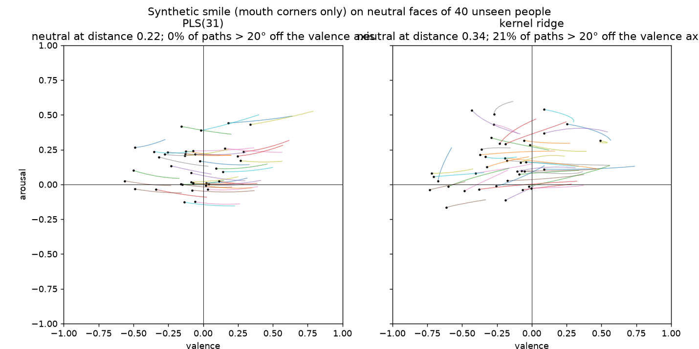

# Model card: facial-expression-analysis v2

Two emotion models are bundled. Both predict **arousal**, **valence** (in [-1, 1]) and
**intensity** (in [0, 1]) from 68 dlib facial landmarks.

| | `emotion_model.npz` (default) | `emotion_model_kernel.npz` |
|---|---|---|
| Estimator | PLS, 31 components (as in 2021) | RBF kernel ridge, 2000-face Nyström basis |
| Strengths | Calibrated, decomposed and pose-robust on unseen faces; interpretable | Highest offline CCC; extreme expressions (scream) |
| Size, latency | 31 KB, 0.01 ms per face | 2.1 MB, 0.33 ms per face |
| Load with | `load_model()` / `LinearEmotionModel.load()` | `KernelEmotionModel.load()` |

## Why the less accurate model is the default

Kernel ridge wins every offline accuracy metric below. In the live webcam demo, however, PLS(31)
behaved better in three ways. This was the author's observation in 2021 and again with the v2
models, and `experiments/12_behavioural_tests.py` confirms it on 2,294 neutral frontal faces of
unseen people (Multi-PIE, CAS-PEAL):

| Behaviour on unseen faces | PLS(31) | Kernel ridge |
|---|---|---|
| **Neutral calibration:** mean distance of neutral faces from (0, 0) | **0.22** | 0.34 |
| Mean valence of neutral faces | **−0.12** | −0.23 |
| **Decomposition:** synthetic smile (mouth corners only), change in V / A | +0.34 / **−0.01** | +0.40 / +0.04 |
| Faces whose smile path deviates > 20° from the valence axis | **0.1%** | 21% |
| **Pose stability:** std of A / V across yaw, same face and expression | **0.075 / 0.131** | 0.091 / 0.137 |

A linear model maps the same facial movement to the same change in output for every face,
so a smile moves along the valence axis for everyone. The kernel model's response depends on
how close the face is to its training faces. On unseen identities that bends the trajectories
and shifts the resting point. MorphSet CCC rewards fitting synthetic labels on the training
population and does not measure any of this. The behavioural tests are now part of the
evaluation.

Neither model needs scikit-learn at inference. dlib detection takes ~14 ms per image and
dominates the latency.

## Pipeline

dlib 68 landmarks → Procrustes normalisation → linear frontalization (retrained in v2) →
1275 pairwise distances between the 51 non-jaw landmarks, divided by a face scale from
expression-stable points → regressor → circumplex label.

PLS(31): 31 components, matching the 2021 choice (≈ the number of facial action units). Nested
CV prefers ~50 components for accuracy (`experiments/06`), but 31 is smoother: less jitter and
more pose-robust.

Kernel model: features standardised; `gamma = 0.5 / 1275`, `alpha = 1`, chosen by nested CV.
The surface is flat: every setting within γ ∈ [0.125, 0.5] × α ∈ [0.1, 10] scored within
0.005 mean CCC of the best, and a 4000-face basis gained nothing.

## Training data

**MorphSet** ([Vonikakis et al., ICIP 2021](https://arxiv.org/abs/2103.02854)) has 83,191 face
images, each with a mirrored copy, of 337 people from RaFD, KDEF, WSEFEP and FACES. The
dimensional labels are *generated*: prototypical expressions were morphed with each person's
neutral face, and the labels interpolated accordingly.

The bundled models were trained on 70% of the persons (seed 1). 20% were used for validation
and 10% for testing. Splits are by **person**: MorphSet's subject ids are photo series, so
grouping by them leaks identity (see `experiments/01_person_identity.py`).

## Offline evaluation

All numbers are concordance correlation coefficients (CCC) unless stated otherwise.
Source: `experiments/08_model_comparison.py` and `experiments/10_error_analysis.py`.

| Axis | Kernel ridge | PLS(31) | Ridge | Gradient boosting | MLP |
|---|---|---|---|---|---|
| 5-fold CV by person (A / V / I) | **0.715 / 0.846 / 0.712** | 0.629 / 0.803 / 0.659 | 0.686 / 0.832 / 0.712 | 0.693 / 0.835 / 0.662 | 0.671 / 0.833 / 0.653 |
| Leave one database out (A / V / I) | **0.691 / 0.804 / 0.677** | 0.634 / 0.775 / 0.622 | 0.662 / 0.800 / 0.678 | 0.671 / 0.800 / 0.626 | 0.647 / 0.800 / 0.627 |
| Jitter: mean \|ΔA\|, \|ΔV\| under 1 px landmark noise | 0.055, **0.069** | **0.046**, 0.088 | 0.062, 0.104 | 0.063, 0.069 | 0.070, 0.071 |
| Pose: mean \|ΔA\| vs frontal at 15° / 45° yaw | 0.076 / 0.132 | **0.065 / 0.096** | 0.084 / 0.117 | 0.084 / 0.126 | 0.091 / 0.144 |
| External: correct sign, scream vs neutral (arousal) | **0.945** | 0.735 | 0.591 | n/a | n/a |

Offline, the kernel model's CV gain is significant: it beats PLS(31) and ridge in every fold on
arousal and valence. Against PLS(31) it gains +0.086 arousal, +0.043 valence and +0.053
intensity. On the held-out test persons it scores **0.703 / 0.831 / 0.722**, against
0.605 / 0.789 / 0.643 for PLS(31).

The external test uses Multi-PIE and CAS-PEAL persons, who are not in MorphSet. Each
expression is compared with the same person's neutral face at the same pose:

| Share of contrasts with the expected sign | Happy (V↑) | Disgust (V↓) | Surprise (A↑) | Scream (A↑) |
|---|---|---|---|---|
| Kernel ridge | 0.951 | 0.841 | 0.975 | 0.945 |
| PLS(31) | 0.941 | 0.874 | 0.974 | 0.735 |

Linear models fail on scream. The squeezed eyes push arousal down and the wide-open mouth
pushes it up, and a linear model sums the two.

A hybrid of PLS(31) plus a kernel model of its residuals tied the kernel model on CV. It was
worse on jitter, pose and scream, so it was not adopted.

## Error analysis (out of fold)

- **Shrinkage.** Predictions are compressed towards the mean. Calibration slopes for PLS(31)
  are 0.47 (A), 0.68 (V) and 0.49 (I); the kernel model has 0.61, 0.77 and 0.60. Neutral faces get intensity
  ≈ 0.3 too high, and the strongest expressions get too little.
- **Hardest expressions** (same for both models, larger for PLS). Sad is read as too aroused
  (bias +0.26 for PLS, +0.21 for kernel). Anger and fear are not aroused enough (PLS −0.21 and
  −0.19).
- **Hardest database: FACES** (older persons). Leave-one-out CCC on FACES (PLS / kernel):
  arousal 0.39 / 0.47, valence 0.64 / 0.67.
- Mirrored faces are predicted as well as the originals.

## Per-person calibration (web demo)

Two neutral photos of the same person produce similar offsets (r ≈ 0.8). The model's reading
of a neutral face therefore depends partly on the person's resting face. The web demo's
**Calibrate neutral** button averages ~1.5 s of a person's neutral face. It then removes only
the **identity offset**: the difference between this person's neutral reading and the average
neutral reading of unseen people, stored as `neutral_mean` in the model metadata (PLS:
A 0.10, V −0.12, I 0.32). Simulated on MorphSet (one neutral photo per person, out of fold):

| Calibration (PLS(31)) | ΔCCC A / V / I |
|---|---|
| Identity offset only (implemented) | +0.01 / −0.01 / −0.06 |
| Subtract own neutral reading (neutral → exactly 0) | −0.04 / −0.06 / −0.33 |
| … with intensity stretched instead of shifted | −0.04 / −0.06 / −0.16 |
| Global neutral-anchored rescaling (no calibration) | +0.03 / −0.04 / −0.18 |

Every variant that makes a neutral face read exactly (0, 0, 0) costs accuracy on expressive
faces. The model's errors near neutral are biased: intensity cannot go below 0, so a neutral
face reads ≈ 0.3 for everyone. With the implemented calibration, a person's neutral face
reads like the average neutral face, which can carry a "slightly …" label. Global variance-
matching rescaling would raise CCC (+0.04 / +0.02 / +0.05). It was not adopted because it
amplifies jitter by 1.2–1.4× and barely moves neutral.

## Limitations

- **Synthetic labels.** The training targets are morph interpolations between posed
  prototypes and neutral faces, not human ratings of spontaneous expressions.
- **Label coverage.** MorphSet labels cover circumplex angles from 10° to 205° only. There are
  no calm, relaxed or sleepy targets, so the model rarely predicts that quadrant (0.6% of
  predictions).
- **Extreme expressions.** PLS(31) misses the arousal of screams in 26% of cases. The squeezed
  eyes and the open mouth cancel in a linear model; use the kernel model if this matters.
- **Arousal is mostly mouth opening.** The facial movement that accompanies higher predicted
  arousal is 83% mouth. Talking, yawning and chewing will read as aroused, so smooth over
  time in video.
- **Posed, frontal, well-lit faces.** Frontalization reduces the pose effect (at 45° the
  arousal shift drops from 0.54 to about 0.1), but accuracy still drops away from frontal.
- **Landmark quality bounds everything.** Errors on real photos come more often from poor dlib
  fits than from the regressor, for example a wide-open mouth or hands on the face.
  `KernelEmotionModel.basis_distance` measures how far a face is from all training faces (the
  webcam demo shows it for either model). The
  validation median is 16.2 and the 99th percentile 26.3, both stored in the model metadata.
  Treat estimates above the 99th percentile as unreliable.
- **Data overlap.** KDEF persons appear both in MorphSet and in the frontalization training
  data. The pose and external tests therefore exclude KDEF.
- **Pose-dataset landmarks.** The Multi-PIE and CAS-PEAL landmarks were most likely fitted
  automatically and selected by the poses each database provides, not checked by hand. About
  1 in 16 scream shapes looked malformed on inspection. The pose, external and behavioural
  tests therefore contain some landmark noise, which affects all models equally.
- **Demographics.** The source databases mainly show young to middle-aged adults of European
  appearance (FACES adds older adults). Performance on other groups is untested.

## Intended use

Research, teaching and interactive demos of dimensional affect estimation. Not suitable for
decisions about individuals, such as hiring, education, policing, health or credit. Facial
movements are not reliable readouts of inner emotional states.
