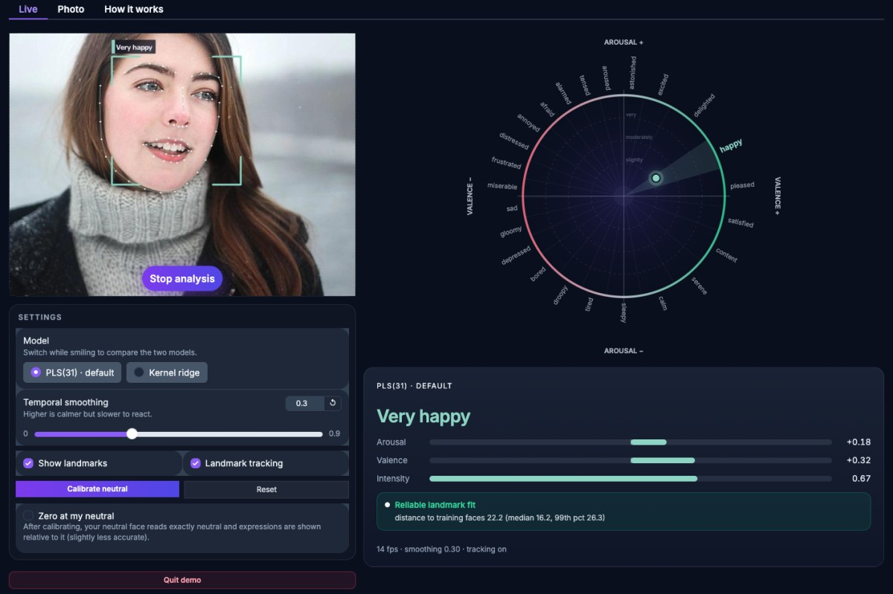
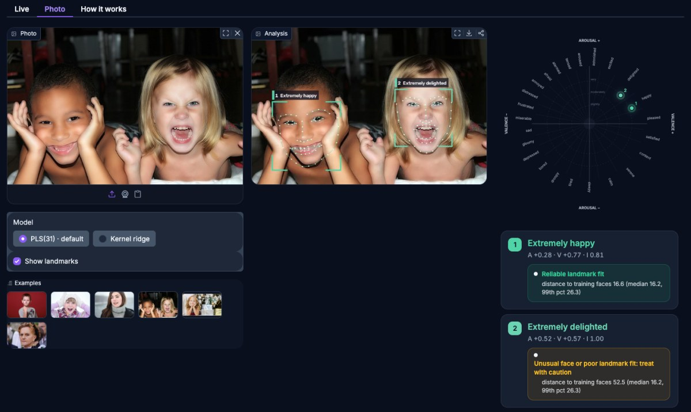
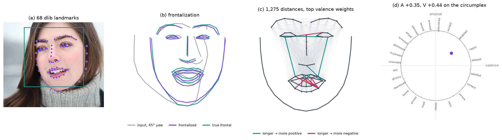
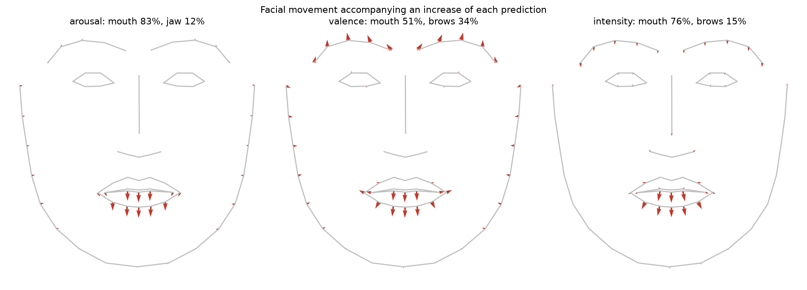
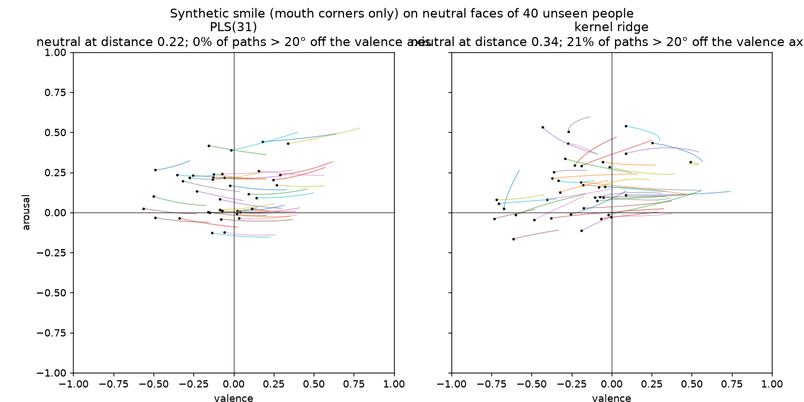

# Facial Expression Analysis

[](https://github.com/bbonik/facial-expression-analysis/actions/workflows/ci.yml)


Estimate **dimensional emotions** (arousal, valence and intensity), plus a verbal label such as
*"Very happy"*, from the geometry of a face. It uses 68 facial landmarks and interpretable
**classical machine learning**. The default model is a 31 KB linear regressor. Everything
after landmark detection takes about 70 µs per face on a laptop CPU, so it runs in real time
with no GPU.



> **v2** (this branch) is a full rewrite of the 2021 code, with bug fixes, a retrained and
> evaluated model, landmark tracking for video and a web demo. The original code is tagged
> [`v1.0.0`](../../tree/v1.0.0).

**Contents:** [Install](#install) · [Use it](#use-it) · [How it works (science)](#how-it-works)
· [Results](#results) · [Repository layout](#repository-layout) · [Development](#development)
· [Citation](#citation) · [Model card](MODEL_CARD.md)

---

## Install

You need **Python 3.11–3.13**. No compiler is needed: dlib comes as a pre-built wheel
(`dlib-bin`). On first use, the dlib landmark model (~100 MB) is downloaded and cached
automatically.

**Recommended: with [uv](https://docs.astral.sh/uv/)**
(`curl -LsSf https://astral.sh/uv/install.sh | sh`):

```bash
git clone https://github.com/bbonik/facial-expression-analysis.git
cd facial-expression-analysis
git checkout v2
uv sync                    # creates .venv with the package and the dev tools
uv run fea download        # optional: pre-fetch the dlib model
```

**With pip:**

```bash
git clone https://github.com/bbonik/facial-expression-analysis.git
cd facial-expression-analysis && git checkout v2
python -m venv .venv && source .venv/bin/activate
pip install -e .           # core: images, webcam, Python API
pip install -e ".[demo]"   # + Gradio web demo
pip install -e ".[train]"  # + training and evaluation (scikit-learn, pandas)
```

| Install | Gives you |
|---|---|
| `pip install -e .` | `fea predict`, `fea webcam`, the Python API (numpy, OpenCV, dlib) |
| `[demo]` | the Gradio web demo |
| `[train]` | `fea train`, `fea evaluate`, `fea train-frontalization`, the experiments |

## Use it

### 1. Web demo (easiest)

```bash
scripts/web_demo.sh            # sets everything up and opens http://localhost:7860
scripts/web_demo.sh --share    # also prints a temporary public link (e.g. to try a phone)
```

- **Live** tab: click *Click to Access Webcam*, then *Start analysis*. It shows up to four
  faces, each with its own colour and trail on the arousal-valence plane. Settings:
  - **Model** switches between PLS(31) and kernel ridge on the same input.
  - **Temporal smoothing** trades calm against reaction speed.
  - **Show landmarks** toggles the landmark overlay.
  - **Landmark tracking** (on by default) keeps the landmarks steadier and helps in low light.
  - **Calibrate neutral** removes your resting-face offset after a 3-second countdown. Keep a
    relaxed face.
  - **Zero at my neutral** makes your calibrated neutral read exactly (0, 0, 0).
- **Photo** tab: upload a photo or pick an example. Every face is analysed, and each gets a
  landmark-fit reliability badge.
- **How it works** tab: the method in brief.

On macOS the browser asks for camera access the first time. Frames are processed in memory
and never stored.



### 2. Analyse photos from the command line

```bash
uv run fea predict examples/kids.jpg -o outputs/    # annotated copy saved in outputs/
uv run fea predict photos/*.jpg --json              # machine-readable output
```

```text
examples/kids.jpg: 2 face(s)
  [1] Extremely delighted      arousal=+0.517 valence=+0.570 intensity=1.000
  [2] Extremely happy          arousal=+0.284 valence=+0.773 intensity=0.814
```

### 3. Real-time OpenCV window

```bash
scripts/demo.sh                 # = fea webcam, after installing and fetching the model
scripts/demo.sh --camera 1      # another camera;  --smoothing 0.6  calmer;  --no-track
```

| Key | Action |
|---|---|
| `m` | switch model (PLS(31) / kernel ridge) |
| `t` | landmark tracking on/off |
| `-` / `+` | less / more temporal smoothing |
| `l` | landmark overlay on/off |
| `q`, `Esc` | quit |

A status bar shows the active model, every setting, the FPS and the landmark-fit distance.

**macOS camera permission:** the terminal app you run this from (Terminal, iTerm, VS Code…)
needs camera access. Enable it in *System Settings → Privacy & Security → Camera*, then quit and
reopen the terminal.

### 4. Python API

```python
from facial_expression_analysis import DlibLandmarkDetector, EmotionEstimator, load_image

estimator = EmotionEstimator()  # bundled PLS(31) model
faces = estimator.analyze_image(load_image("face.jpg"), DlibLandmarkDetector())
for face in faces:
    e = face.emotion
    print(e.label, e.arousal, e.valence, e.intensity)

# Landmarks from elsewhere: any (n, 68, 2) array in dlib order, vectorised
avi = estimator.predict(landmarks)  # (n, 3): arousal, valence, intensity

# The kernel model instead of PLS(31)
from facial_expression_analysis import KernelEmotionModel

estimator = EmotionEstimator(KernelEmotionModel.load())
```

For video, use the tracker. It is stateful, so use one per stream:

```python
from facial_expression_analysis.landmarks import LandmarkTracker

tracker = LandmarkTracker()  # robust dlib fits, boxes from the last frame
for frame in video_frames:  # RGB uint8 arrays
    for face in estimator.analyze_image(frame, tracker):
        ...
```

### 5. Retrain and evaluate (needs `[train]`)

```bash
uv run fea train                                 # PLS(31); MorphSet downloads on first use
uv run fea train --estimator kernel_ridge -o models/kernel.npz
uv run fea evaluate -m models/emotion_model.npz  # CCC on held-out test persons
uv run fea train-frontalization                  # retrain the frontalization model
uv run fea benchmark examples/happy.jpg          # per-stage latency
```

Every number in this README can be reproduced with the scripts in
[`experiments/`](experiments/README.md).

---

## How it works



```
image ─▶ face box ─▶ 68 landmarks ─▶ Procrustes ─▶ frontalization ─▶ 1,275 distances / scale
      ─▶ PLS regression ─▶ (arousal, valence, intensity) ─▶ circumplex label
```

The approach is deliberately geometric and linear. Expressions are movements of facial parts,
and those are captured well by landmark distances. A linear model on such features is small,
fast and explainable: each output is a weighted sum of distances, and the weights can be drawn
back on the face. It also behaves predictably on faces it has never seen (see
[Model selection](#model-selection-why-the-linear-model-is-the-default)).

### 1. Dimensional affect

Instead of picking one of a few categories ("happy", "angry"…), the model places a face in
**Russell's circumplex** (Russell, 1980):

- **valence** ∈ [−1, 1]: unpleasant ↔ pleasant;
- **arousal** ∈ [−1, 1]: calm ↔ activated;
- **intensity** ∈ [0, 1]: distance from neutral.

Mixed and subtle expressions get in-between values instead of being forced into a class.

### 2. Training data: MorphSet

Dimensional labels for facial expressions are expensive to collect and noisy. **MorphSet**
([Vonikakis et al., ICIP 2021](https://arxiv.org/abs/2103.02854)) generates them instead:

1. **Source photos.** It starts from posed photos in four databases: RaFD, KDEF, WSEFEP and
   FACES.
2. **Morphing.** Each person's neutral face is morphed towards their apex expressions in
   10 steps. The targets are the basic expressions and blends of neighbouring ones: anger +
   disgust, disgust + sadness and happiness + surprise (each blend at three ratios), and
   surprise + fear.
3. **Labels.** Every prototype has a direction on the circumplex (happiness ≈ 10°, surprise ≈
   70°, fear ≈ 100°, anger ≈ 115°, disgust ≈ 145°, sadness ≈ 205°). A morph's label points in
   that direction, with a radius that grows with the morph step: (V, A) = r·(cos θ, sin θ).
   Its intensity is exactly that radius, r = √(A² + V²).

The result is **83,191 faces of 337 people**. Each face also has a horizontally mirrored copy
with independently detected landmarks. The images are not redistributed; the dataset holds
the dlib landmarks and labels.

Two properties of the data matter for evaluation (both found during the v2 rewrite):

- **Identity.** The `Subject` column identifies photo series, not people. RaFD gives each
  person 3 ids (gaze directions), and KDEF and FACES give 2 (sessions). 711 "subjects" are
  337 people. All splits here are made by **person**, otherwise the same face appears in
  training and test data (`experiments/01_person_identity.py`).
- **Mirrored copies** share person and labels, so they always stay on the same side of a split.

### 3. Landmarks

dlib's **HOG face detector** finds a box. Its **ensemble of regression trees** (Kazemi &
Sullivan, CVPR 2014) then fits the 68-point iBUG-300W landmark scheme inside it, starting from
a mean shape placed in the box. Each tree compares the intensities of pixel pairs, indexed
relative to the current shape, against learned thresholds.

Two properties of this fitter shaped the video pipeline:

- **It depends on the box.** It was trained on boxes from dlib's detector, and its
  convergence depends on where the box sits on the face.
- **It depends on contrast.** Raw pixel differences against fixed thresholds weaken when a face
  is dim or flat. In simulation, a darker image with almost no noise triples the landmark
  error.

#### Landmark tracking for video

Re-running the detector on every frame has two problems. Its boxes jump, because HOG works on
an 8-pixel grid and a coarse scale pyramid: shifting a face by 1 px changes the landmarks by
1.2–1.6% of the eye distance. And in low light it misses faces. The tracker
(`landmarks/tracker.py`) instead builds each frame's box from the previous frame's landmarks.

**Learned box (`BoxRegressor`).** A tight rectangle around the landmarks is too small and
mis-placed, and the fitter converges badly from it. That was the reason earlier attempts at
landmark tracking failed. Instead, a small linear model learns *the box the detector would have
drawn*:

1. The landmarks are centred and divided by their RMS radius *s* (similarity-normalised,
   136 values).
2. Ridge regression predicts the box centre offset in units of *s*, and log(width / *s*) and
   log(height / *s*).
3. It is trained on 12,960 LFW photos (detector box + dlib fit). By construction the box moves
   and scales with the face.

| Box built from the landmarks | IoU with detector box | Landmark difference vs detector-based fit | Fits > 5% off |
|---|---|---|---|
| Tight landmark rectangle | 0.70 | 5.2% | 19.8% |
| Tight rectangle + mean offset/scale | 0.78 | 2.5% | 5.9% |
| **Learned box** | **0.87** | **1.2%** | **0.7%** |

All errors are in % of the outer eye-corner distance, on 2,000 faces of people not used for
training. The learned box's 1.2% is within the detector's own noise floor (1.2–1.6%).
Iterating box → fit → box 30 times on the same image does not drift (1.17% → 1.26%).

**Robust fit** (`DlibLandmarkDetector.fit(..., robust=True)`). All changes are linear or
smoothing, with no CLAHE or other local enhancement that would distort the face:

- **Contrast gain:** if the face box is dimmer than a typical well-lit face (grey-level std
  < 43.7), it gets a linear contrast gain. Contrast is never reduced.
- **Blur:** a slight Gaussian blur (σ = box width / 110 px) suppresses sensor noise.
- **Averaging:** the fit is repeated from five boxes shifted by ±4% and averaged.
- **Spread as a loss signal:** the disagreement between those five fits (*spread*) is below
  2% on faces and above 3% when the box no longer holds a face. Above 3% on two frames in a
  row, the tracker drops the face. On the first doubtful frame it re-runs the detector at once.

The detector still runs when nothing is tracked, and every 5th frame to find new faces.
Low-contrast frames are stretched linearly before detection.

**Simulated video** (`experiments/13_tracking.py`). Each sequence is 250 LFW faces × 15 frames
with slow random head motion. Low light is simulated with darkening, Gaussian sensor noise and
8-bit quantisation, with and without camera auto-gain. A/V error and jitter are for the default
model:

| Condition | Pipeline | Landmark error | Landmark jitter | A/V jitter | Frames without a face |
|---|---|---|---|---|---|
| Clean | detector every frame (v1) | 1.58% | 1.44% | 0.171 | 0.1% |
| Clean | **tracker** | **1.44%** | **0.73%** | **0.096** | **0.0%** |
| Night, camera auto-gain | detector every frame | 2.84% | 2.92% | 0.236 | 10.2% |
| Night, camera auto-gain | **tracker** | **1.58%** | **1.16%** | **0.113** | **5.6%** |
| Dark, no auto-gain | detector every frame | 9.86% | 4.48% | 0.168 | 50.1% |
| Dark, no auto-gain | **tracker** | **1.66%** | **1.15%** | **0.113** | **5.3%** |

The tracker is also about twice as fast: 5.9 ms against 12.3 ms per 640 px frame. Single
photos keep the plain fit, so their landmarks match the ones the models were trained on.

### 4. Shape normalisation (Procrustes)

Position, size and in-plane rotation carry no expression. Each shape is centred on its
centroid, divided by its RMS radius and rotated so that the line joining the eye centres is
horizontal. All 68 points are used, as when the frontalization model was trained.

### 5. Frontalization

Head pose changes 2-D landmark geometry far more than many expressions do. Turning the head by
45° shifts the predicted arousal by 0.54 without correction. **Frontalization**
([Vonikakis & Winkler, ICIP 2020](https://stefan.winkler.site/Publications/icip2020a.pdf))
estimates how the shape would look from the front with a single linear map:

[x′₁ … x′₆₈, y′₁ … y′₆₈] = [x₁ … x₆₈, y₁ … y₆₈, 1] · **W**, where **W** is 137 × 136.

- **Training data.** It is trained on a multi-pose dataset: 42,846 shapes of 2,169 subjects,
  yaw 0°–67°, pitch ±20°, several expressions (Multi-PIE, KDEF and, most likely, CAS-PEAL).
  Each posed shape is paired with the frontal shape of the same person and expression.
- **Identity invariance.** In the targets, each facial part (eyes, nose, mouth, jaw) is moved
  to its position in a mean face; the eyebrows follow their eye. The map therefore learns to
  remove the pose *and* some of the person-specific geometry, keeping the expression.
- **v2 changes.** Retrained by least squares without the naive mirroring augmentation of 2021:
  −9% frontalization error, +0.011 arousal CCC on MorphSet in 10 of 10 folds
  (`experiments/07`, `09`).
- **Effect.** At 45° yaw, the arousal shift relative to frontal falls from 0.54 to 0.11
  (Multi-PIE).

### 6. Geometric features

The features are the Euclidean distances between **all pairs of the 51 non-jaw landmarks**:
C(51, 2) = 1,275 values. Each is divided by a face scale measured on **expression-stable
points** (the nose and the eye corners).

- **No jaw.** The jaw contour is the least reliable part of a dlib fit and carries little
  expression. Adding it costs 0.011 intensity CCC.
- **Stable scale.** Normalising by the whole face would let an open mouth or raised eyebrows
  inflate the scale (+5.6% for surprise) and shrink every other distance. With the stable
  scale, each distance responds only to its own two landmarks (+0.4%).
- **Template bug fixed.** The 2021 code had been ported from a MATLAB system built on the
  49-point IntraFace scheme. Its feature template indexed the 68-point array with 49-point
  positions, so it silently used the jaw and dropped 17 of the 20 mouth landmarks. Fixing it
  improved CCC by +0.021 / +0.009 / +0.019 (A / V / I), better in every fold
  (`experiments/04`, `05`).

### 7. Regression

**PLS regression (default).** Partial Least Squares (`sklearn.cross_decomposition.PLSRegression`)
works on standardised features and targets:

- It finds 31 latent directions in the 1,275-dimensional feature space that maximise covariance
  with the three targets, and regresses the targets on them.
- This suits many strongly correlated features (distances that share landmarks), and it
  predicts arousal, valence and intensity jointly.
- 31 components roughly match the number of facial action units. Nested CV prefers about 50 for
  raw accuracy (`experiments/06`), but 31 jitters less and is more robust to pose.
- **Export.** The fitted model is collapsed into a single affine map, **ŷ = x·B + b**. B is
  1,275 × 3 and stored in a 31 KB `.npz`, so inference needs only numpy, no scikit-learn.
- **Intensity** is predicted directly rather than computed as √(² + V̂²) from the predictions,
  which is 0.058 CCC better.

**Kernel ridge (bundled alternative).** The features are standardised and an RBF kernel is
approximated on a **Nyström** basis of 2,000 training faces (γ = 0.5 / 1,275), followed by
ridge regression (α = 1). The hyperparameters were chosen by nested CV. The basis is stored as
frontal landmarks, so the exported model (2.1 MB) also needs only numpy. It has the best
offline accuracy and handles extreme expressions (screams) better. The distance from a face to
its nearest basis face doubles as a **reliability signal**: above the validation 99th
percentile (26.3), the landmarks have probably fitted badly. The demos show this for either
model.

**Interpretability.** Because the model is linear in distances, its gradient with respect to
the landmarks gives the facial movement that raises each output (`experiments/11`):

- **Arousal** is 83% mouth: opening and stretching.
- **Valence** is the lip corners and the brows.
- **Intensity** is overall mouth activity.



### 8. Labels

The angle θ = atan2(A, V), measured counter-clockwise from positive valence, selects one of
**24 emotion words** around the circumplex: pleased, happy, delighted, excited, astonished,
aroused, tensed, alarmed, afraid, annoyed, distressed, frustrated, miserable, sad, gloomy,
depressed, bored, droopy, tired, sleepy, calm, serene, content and satisfied.

The predicted intensity selects a qualifier: *slightly* (< 0.325), *moderately* (< 0.55),
*very* (< 0.775) or *extremely*. Below 0.1, the face is *neutral*.

### 9. Per-person calibration

People's resting faces differ: two neutral photos of the same person give similar offsets
(r ≈ 0.8). *Calibrate neutral* averages about 1.5 s of a person's neutral face. It subtracts
only the **identity offset**: their neutral reading minus the average neutral reading of unseen
people, which is stored in the model. It refuses faces that are clearly not neutral, or poorly
fitted.

Making a neutral face read exactly (0, 0, 0) costs accuracy on expressive faces, because
predictions near neutral are biased (intensity cannot go below 0). The trade-off is therefore
optional (*Zero at my neutral*) and quantified in the
[model card](MODEL_CARD.md#per-person-calibration-web-demo).

### 10. Evaluation protocol

- **Splits by person.** Models are trained on 70% of the persons, validated on 20% and tested on
  10%. Model selection uses 5-fold CV **grouped by person**, with paired per-fold comparisons
  and Nadeau–Bengio corrected tests.
- **Metric:** the concordance correlation coefficient, CCC = 2ρσₓσᵧ / (σₓ² + σᵧ² + (μₓ − μᵧ)²).
  It penalises both low correlation and bias or scale errors.
- **Beyond MorphSet:**
  - leave-one-database-out;
  - jitter under 1 px landmark noise;
  - pose invariance across yaw;
  - the sign of expression-versus-neutral contrasts on Multi-PIE and CAS-PEAL persons, who are
    not in MorphSet;
  - **behavioural tests** on unseen faces: is a neutral face near (0, 0)? Does a synthetic smile
    move along the valence axis? How stable is the output across head pose?

---

## Results

### Model selection: why the linear model is the default

Seven regressors were compared (`experiments/08_model_comparison.py`). CCC for arousal /
valence / intensity:

| Model | 5-fold CV by person | Leave one database out | Scream raises arousal |
|---|---|---|---|
| Kernel ridge | **0.715 / 0.846 / 0.712** | **0.691 / 0.804 / 0.677** | **95%** |
| Ridge | 0.686 / 0.832 / 0.712 | 0.662 / 0.800 / 0.678 | 59% |
| Gradient boosting | 0.693 / 0.835 / 0.662 | 0.671 / 0.800 / 0.626 | – |
| MLP | 0.671 / 0.833 / 0.653 | 0.647 / 0.800 / 0.627 | – |
| **PLS, 31 components (default)** | 0.629 / 0.803 / 0.659 | 0.634 / 0.775 / 0.622 | 74% |

Kernel ridge wins offline. In the live demo, however, PLS(31) behaved better. Behavioural tests
on 2,294 neutral faces of unseen people confirm it (`experiments/12_behavioural_tests.py`):

| On unseen faces | PLS(31) | Kernel ridge |
|---|---|---|
| Neutral faces: mean distance from (0, 0) | **0.22** | 0.34 |
| Synthetic smile: paths > 20° off the valence axis | **0.1%** | 21% |
| Prediction spread across head yaw (arousal) | **0.075** | 0.091 |

A linear model maps a facial movement to the same output change for every face. The kernel
model's response bends with identity. CCC on synthetic morph labels does not measure this, so
the behavioural tests are now part of model selection.



### Features (5-fold CV by person, PLS(31), CCC mean ± sd)

| Features | Arousal | Valence | Intensity |
|---|---|---|---|
| 2021 template (bug) | 0.600 ± 0.020 | 0.795 ± 0.011 | 0.637 ± 0.013 |
| **51 non-jaw landmarks, stable scale (default)** | **0.616 ± 0.019** | **0.806 ± 0.011** | **0.654 ± 0.019** |
| 51 non-jaw landmarks, subset scale | 0.620 ± 0.020 | 0.804 ± 0.011 | 0.656 ± 0.019 |
| 49 IntraFace landmarks, stable scale | 0.618 ± 0.019 | 0.804 ± 0.012 | 0.655 ± 0.018 |
| All 68 landmarks, stable scale | 0.615 ± 0.020 | 0.804 ± 0.011 | 0.644 ± 0.018 |

Grouping by subject id instead of person overstates CCC by about 0.007 and halves the apparent
fold-to-fold variance.

### Speed (Apple M3, 640 × 426 image)

| Stage | Time |
|---|---|
| dlib detection + landmarks | 14.4 ms |
| Tracker (per video frame, 640 px) | 5.9 ms |
| Frontalization + features + PLS + label | 0.07 ms (kernel: 0.39 ms) |

### Limitations

These are in short; details are in the [model card](MODEL_CARD.md#limitations).

- **Synthetic labels.** The labels come from posed, morphed expressions.
- **Missing quadrant.** There are no calm or sleepy targets.
- **Arousal is mostly mouth opening.** Talking and yawning read as aroused.
- **Screams.** Linear models under-read the arousal of screams.
- **Landmark quality.** Accuracy is bounded by the quality of the landmarks.
- **Demographics.** The training faces are mostly young to middle-aged adults of European
  appearance.
- **Intended use.** For research and demos only. Not for decisions about people.

---

## Repository layout

```
facial-expression-analysis/
├── src/facial_expression_analysis/   the package (inference needs only numpy, OpenCV, dlib)
│   ├── landmarks/        detector interface, dlib back-end + robust fit, tracker, box regressor
│   ├── geometry.py       Procrustes normalisation (vectorised)
│   ├── frontalization.py linear landmark frontalization
│   ├── features.py       pairwise-distance features, scale references
│   ├── model.py          portable linear and kernel models (.npz, no scikit-learn at inference)
│   ├── pipeline.py       EmotionEstimator: images / landmarks → emotions
│   ├── labels.py         circumplex labels
│   ├── io.py, viz.py     image loading, drawing
│   ├── cli.py, live.py   `fea` command line, OpenCV webcam demo
│   ├── assets/           bundled models: emotion (PLS, kernel), frontalization, box regressor
│   └── training/         needs [train]: MorphSet loading and splits (data), training (train),
│                         grouped CV and tests (evaluation), metrics, frontalization training,
│                         interpretability (interpret)
├── app/                  Gradio web demo (app.py layout, core.py engine, render.py SVG/HTML)
├── scripts/              web_demo.sh, demo.sh, deploy_space.sh (Hugging Face), readme_figures.py
├── experiments/          13 reproducible analyses behind every claim (see its README)
├── tests/                unit, regression and equivalence tests against the 2021 outputs
├── examples/             sample photos (used by the demos and tests)
├── docs/                 figures (from the experiments) and README screenshots
├── MODEL_CARD.md         evaluation, calibration, limitations, intended use
└── CHANGELOG.md
```

These are not in git and are downloaded or created on demand:
- the dlib model and MorphSet, in the user cache (`$FEA_CACHE_DIR` overrides it);
- `data/`, for your own copy of datasets;
- `models/`, the output of `fea train`;
- `outputs/`, experiment results.

## Development

```bash
uv sync                                             # Python env with dev tools
uv run pytest                                       # 132 tests, incl. v1 equivalence checks
uv run ruff check . && uv run ruff format --check . && uv run mypy
uv run pre-commit install                           # run the checks on every commit
scripts/deploy_space.sh --dry-run                   # build the Hugging Face Space folder
```

CI runs lint, types and tests on Linux and macOS with Python 3.11–3.13.

## Citation

If you use this code in your research, please cite:

1. [V. Vonikakis, D. Neo Yuan Rong, S. Winkler. (2021). MorphSet: Augmenting categorical emotion datasets with dimensional affect labels using face morphing. Proc. ICIP 2021.](https://arxiv.org/abs/2103.02854)
2. [V. Vonikakis, S. Winkler. (2021). Efficient Facial Expression Analysis For Dimensional Affect Recognition Using Geometric Features.](https://arxiv.org/abs/2106.07817)
3. [V. Vonikakis, S. Winkler. (2020). Identity Invariant Facial Landmark Frontalization for Facial Expression Analysis. Proc. ICIP 2020.](https://stefan.winkler.site/Publications/icip2020a.pdf)

Other references: J. A. Russell (1980), *A circumplex model of affect*, J. Personality and
Social Psychology 39(6). V. Kazemi & J. Sullivan (2014), *One millisecond face alignment
with an ensemble of regression trees*, CVPR. Labeled Faces in the Wild (Huang et al., 2007)
was used to train the box regressor.
