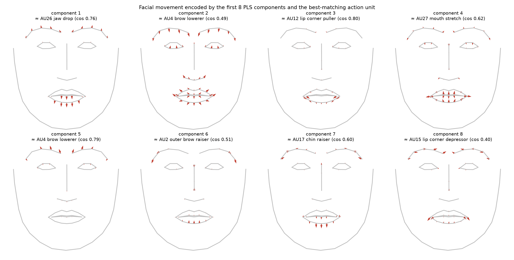
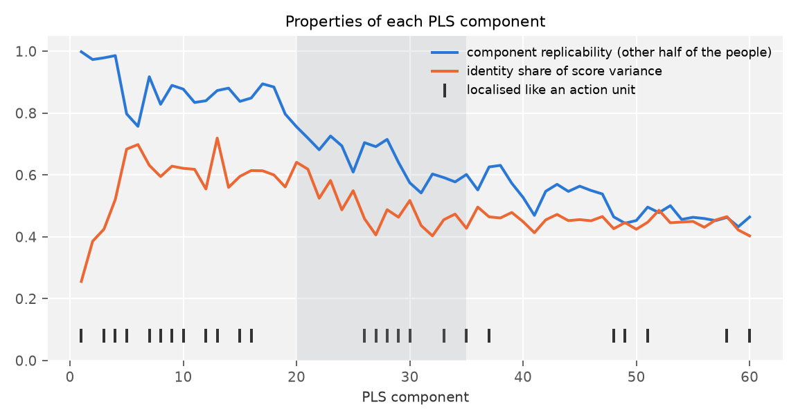
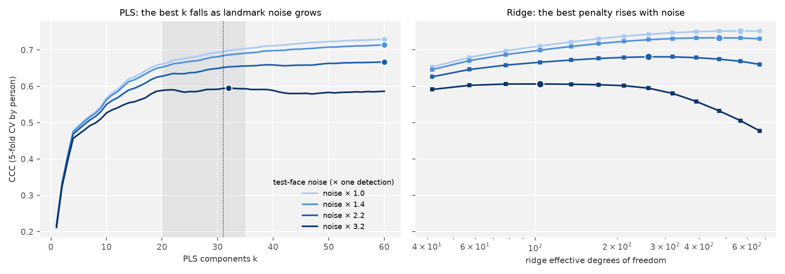
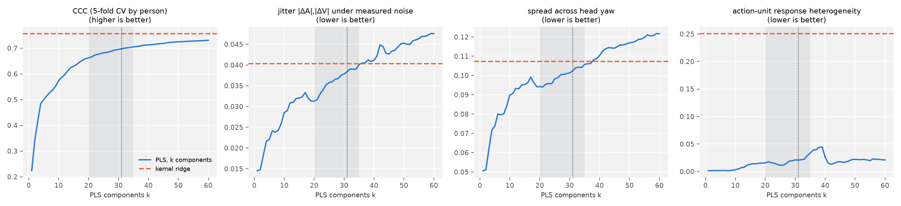
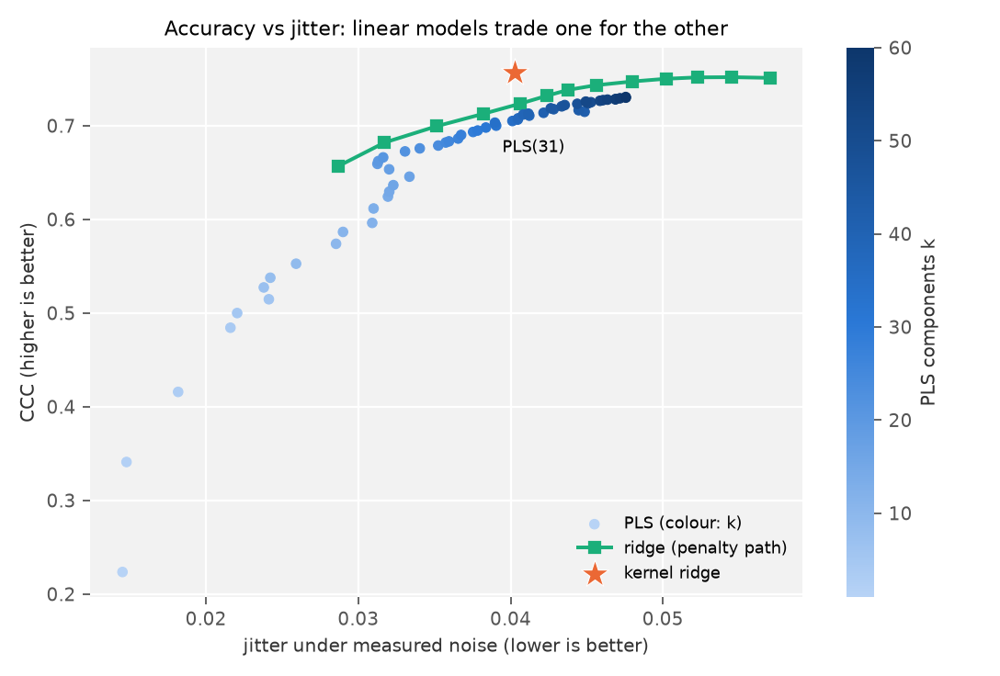

# Why a low-dimensional linear model wins in real time: landmark noise, expression dimensionality and action units in geometric affect regression

*Vassilios Vonikakis. Analyses and draft prepared with Claude (Anthropic). Working paper, November 2026.*

**Reproduce:** every number and figure comes from `experiments/14_pls_dimensionality.py` (about
10 minutes on a laptop CPU), using the data and code of this repository. Raw outputs:
`outputs/14_*.csv` and `outputs/14_log.txt`.

---

## Abstract

A linear Partial Least Squares (PLS) regressor with 31 components, applied to pairwise distances
between 51 facial landmarks, estimates arousal, valence and intensity in real time. Two
observations motivated this study. First, 31 is close to the number of facial action units
(AUs) defined by the Facial Action Coding System (FACS). Second, in a live webcam demo the
31-component model behaves better than models that are more accurate in cross-validation,
including ridge regression and RBF kernel ridge regression.

We measure the landmark detector's noise directly, using MorphSet's mirrored image copies as
independent re-detections of the same faces. We then ask how many directions of facial expression
rise above that noise, what PLS components encode, and how model complexity trades accuracy
against live behaviour. The data are 83,191 images of 337 people (MorphSet) and frontal and
multi-pose faces of 1,202 people (Multi-PIE, KDEF, CAS-PEAL).

1. **The noise is about 1 px and highly structured.** One dlib detection has a noise standard
   deviation of 0.98 px per coordinate at a 150 px eye distance. Ten of the 102 shape directions
   carry 90% of it.
2. **Expression has about 20 strong and 30 reliable dimensions.** Within-person deformations
   exceed four times the noise in 21 directions and twice the noise in 30. They exceed the noise
   itself in about 40. Faces of different people (identity) have almost the same spectrum.
3. **PLS components 1–20 are action units.** Each of the first 10 matches an AU template, and 8
   of the next 10 do. After component 20, matches drop to chance, replicability across people
   falls, and the signal-to-noise ratio (SNR) drops from about 13 to 1–3.
4. **Noise sets the accuracy-optimal complexity.** At photo-quality noise, cross-validation
   prefers the most complex models. When the test faces carry 3.2 times the noise of one
   detection (what our simulation gives for the original detector in a dim webcam scene), the
   optimum drops to 32 PLS components, and for ridge to 104 effective degrees of freedom. That
   ridge model behaves like PLS(31).
5. **Live behaviour adds further penalties.** Jitter and pose sensitivity grow with complexity.
   The kernel model's response to the same synthetic AU varies about 12 times more across faces
   than a linear model's.
6. **The good behaviour is not specific to PLS.** A ridge regression at matched complexity
   matches or beats PLS(31) on every measure.

The "coincidence" therefore has a concrete explanation. Through 51 landmarks and a detector with
about 1 px of noise, a face resolves about 30 reliable movement patterns, comparable to the
number of landmark-visible action units. A model of that complexity is what accuracy itself
selects once the noise reaches webcam levels. Model selection for interactive affect estimation
should therefore be done at the noise level of deployment, and complemented with behavioural
tests.

---

## 1. Introduction

Geometric facial-expression models map facial landmarks to affect. In the system studied here,
dlib's 68-point landmarks (Kazemi & Sullivan, 2014) are normalised for position, scale and
in-plane rotation, frontalized by a linear map (Vonikakis & Winkler, 2020), and turned into
1,275 distances between the 51 non-jaw landmarks. The distances are divided by a scale measured
on expression-stable points. A regressor then predicts arousal, valence and intensity, the
dimensions of Russell's circumplex model of affect (Russell, 1980; Vonikakis & Winkler, 2021). The
regressor is trained on MorphSet (Vonikakis et al., 2021), whose dimensional labels are generated
by morphing each person's neutral face towards their posed expressions.

The original 2021 system used PLS with 31 components. This number was not chosen by
cross-validation. It was the author's choice: roughly the number of facial action units, and the
model that behaved best in a live demo. A modern evaluation of the same system
(`experiments/06`, `08`, `12`) found that:

- nested cross-validation prefers about 50 components;
- ridge and RBF kernel ridge regression are more accurate in person-grouped cross-validation and
  when generalising to a held-out database;
- PLS(31) nevertheless behaves better on new faces. Neutral faces land nearer the origin, a
  synthetic smile moves along the valence axis, and outputs vary less across head pose.

This paper asks why. Specifically:

- **Q1.** How large is the landmark noise, and how many independent directions of facial
  expression rise above it?
- **Q2.** Do PLS components correspond to action units, and up to which component?
- **Q3.** Why does offline accuracy select a more complex model than live use does, and what
  determines the right complexity?

The paper's main tool is a careful separation of **signal** (real changes of facial geometry)
from **noise** (the detector's error). Section 2.2 describes how this is possible when the
detector's output is all we have.

## 2. Data and methods

### 2.1 Data

- **MorphSet** (Vonikakis et al., 2021): 83,191 images of 337 people from RaFD, KDEF, WSEFEP
  and FACES. Each person's neutral face is morphed in 10 steps towards 7 basic expressions and 4
  blends. All images are scaled so that the eye centres are 150 px apart. The dataset ships dlib
  landmarks of every image, plus those of a horizontally mirrored copy of every image (Section
  2.2). MorphSet's subject ids identify photo series, not people, so all splits use corrected
  person ids (`facial_expression_analysis.training.data`). Except for the noise measurement, we
  use the original images only.
- **Real expressions:** the multi-pose landmark dataset used to train the frontalizer. It covers
  Multi-PIE, KDEF and, most likely, CAS-PEAL, with 42,834 shapes of 1,202 people. For
  dimensionality we use frontal views (2,323 expressions with a neutral face of the same person).
  For behaviour tests we use Multi-PIE and CAS-PEAL people only, because KDEF people also appear
  in MorphSet: 2,294 neutral frontal faces and 23,795 faces at yaw ≤ 45°. The origin of these
  landmarks (detector or manual annotation) is not documented, so their noise is unknown.

### 2.2 Signal, noise, and how to separate them

**The problem.** We never observe the true facial geometry. Every shape in the data is the output
of dlib's detector, which adds an error to the true positions of the landmarks:

$$x = s + e,$$

where $x$ is the detected shape (102 numbers: 51 landmarks × 2 coordinates), $s$ is the true
shape and $e$ is the detection error, with covariance $\Sigma_e$. The variance in any direction of
shape space is the sum of real variation and noise, so no analysis of $x$ alone can tell them
apart. We need an independent measurement of $\Sigma_e$.

**Measuring the noise: mirror twins.** MorphSet contains a horizontally mirrored copy of every
image, and dlib detected landmarks on each copy independently. A mirrored face has the same
geometry, flipped. Dlib's HOG face detector and its cascade of regression trees are not
mirror-symmetric, though. On the mirrored image the detector returns a different box, and the
trees take different branches. The two detections therefore make different errors on the same
face. To compare them we undo the mirror on the second detection: we negate its x coordinates and
swap the left and right landmark labels (left eye corner ↔ right eye corner, and so on). The
difference between the twins is then

$$d = x_1 - \tilde x_2 = (s + e_1) - (s + e_2) = e_1 - e_2.$$

The true shape cancels, and what remains is pure detection error. If the two errors are
independent with the same covariance, $\operatorname{Cov}(d) = 2\Sigma_e$. Two corrections apply.
We remove the mean of $d$ over all 83,191 pairs, because it is a systematic left/right asymmetry
of dlib (0.33 px rms), not a random error. We also remove the translation of each pair, which
the mirroring changes. We estimate $\Sigma_e$ in each coordinate system used below: raw pixels,
Procrustes-normalised shapes, frontalized shapes, and the 1,275 distance features.

From the same differences we build a **noise bank**: 83,191 vectors $d/\sqrt 2$, each a
realistic single-detection error with the correct correlations between landmarks. To add
detector-like noise to any face, we draw a random vector from the bank and scale it to the face's
eye distance. All noise simulations in this paper use this bank, not idealised Gaussian noise.

The twin noise captures the part of the error that changes between detections, which is what
appears as frame-to-frame jitter. It misses errors that both detections share. If the image is
blurred or ambiguous in a mirror-symmetric way, both detections may err in the same way. The
twin estimate is thus a lower bound on the total error, but the right quantity for jitter.

**Measuring the signal.** Expressions are measured as within-person **deformations**: an
expression shape minus the same person's neutral shape. Each deformation contains two
detections, so

$$\delta = x_{\text{expr}} - x_{\text{neutral}} = (s_{\text{expr}} - s_{\text{neutral}}) + (e_1 - e_2),$$

$$\operatorname{Cov}(\delta) = \Sigma_s + 2\Sigma_e,$$

where $\Sigma_s$ is the covariance of the true expression changes, the signal. Since $\Sigma_e$ is
measured independently, the signal covariance follows by subtraction:
$\Sigma_s = \operatorname{Cov}(\delta) - 2\Sigma_e$. For shapes of different people's neutral
faces (identity), only one detection is involved, and $\Sigma_s = \operatorname{Cov}(x) -
\Sigma_e$.

**Signal-to-noise ratio.** Along a direction $v$ of shape or feature space, we define

$$\mathrm{SNR}(v) = \frac{v^\top \Sigma_s v}{v^\top \Sigma_e v} = \frac{v^\top \operatorname{Cov}(\delta)\, v}{v^\top \Sigma_e v} - 2.$$

This is the variance of real expression movement along $v$ divided by the noise variance of one
detection along $v$. It is the relevant ratio for live use. After calibration on many neutral
frames, each new frame carries the noise of one detection. SNR = 1 means that the expression
signal along that direction is as large as the frame-to-frame noise.

**Counting dimensions.** To find how many directions have SNR above a threshold, we use the
generalised eigenvalues of $\operatorname{Cov}(\delta)$ relative to $\Sigma_e$. This is the
maximum-noise-fraction transform of remote sensing (Green et al., 1988). We whiten the
coordinates by the noise, so that noise has unit variance in every direction, and compute the
principal components of the whitened data. Each eigenvalue minus 2 is the SNR of one direction,
and the directions are uncorrelated in both signal and noise. This count has an important
property: it does not change under any invertible linear map of the coordinates. Frontalization,
a linear map, cannot create or remove dimensions. A naive count compares the ordinary
eigenvalues of $\operatorname{Cov}(\delta)$ with a single average noise level, and so it depends
on how the noise is distributed across directions. We report both counts.

Finite samples make eigenvalues spread even without signal. A direction counts as statistically
detectable when its eigenvalue exceeds the upper edge of the Marchenko–Pastur distribution for
pure noise, $(1 + \sqrt{p/n})^2$, with $p$ coordinates and $n$ samples (Marchenko & Pastur, 1967).
Detectable does not mean useful. For live use, the thresholds SNR > 1 and SNR > 2 matter more.

### 2.3 Action-unit templates

Without AU-annotated landmark data, we wrote geometric templates for 16 AUs that move the 51
landmarks: AU1, 2, 4, 5, 6, 7, 9, 10, 12, 15, 17, 20, 23, 25, 26 and 27. Each is a symmetric,
unit-norm displacement field derived from the FACS description (Ekman, Friesen & Hager, 2002).
Examples: AU12 moves the lip corners up and outwards; AU5 raises the upper eyelids. The templates
encode direction, not magnitude (`facial_expression_analysis.training.action_units`).

### 2.4 Experiments

The analyses form five experiments, in the order of the script.

**N. Landmark noise.** Mirror-twin differences of all 83,191 image pairs (Section 2.2), in
pixels (per region and overall), in normalised shape coordinates and in feature space. To compare
with the simulated webcam video of `experiments/13`, we also express the twin difference in that
experiment's "landmark jitter" units. Those units are the mean landmark displacement between two
detections, in percent of the outer eye-corner distance.

**A. Intrinsic dimension.** We compute the noise-whitened SNR spectrum (Section 2.2) for three
sets of 51-landmark shapes:

- apex MorphSet expressions minus the same person's neutral face (8,248 deformations);
- real frontal expressions minus neutral (2,323);
- neutral faces of different people, as a reference for identity (711).

We do this both after frontalization and with Procrustes normalisation only, since MorphSet faces
are frontal anyway. The twin noise covariance does not apply to the real-expression dataset,
whose landmarks come from a different source. For that set we report only the naive count,
which uses the same yardstick for morphed and real expressions.

**B. What PLS components encode.** A PLS model with 60 components is fitted to standardised
features of all MorphSet images. For each component:

- *Facial movement:* the minimum-norm landmark displacement that produces the component's
  feature loading, by least squares through the Jacobian of the distances on the mean face.
- *AU match:* the absolute cosine between the movement and the best AU template. The null comes
  from 300 random feature-space directions; we use its 95th percentile (0.31).
- *AU coverage:* the share of each template's energy that lies in the span of the first *k*
  component movements, compared with *k* random directions.
- *Localisation:* one minus the normalised entropy of the movement's energy over facial regions.
  A component counts as localised above the random-direction 95th percentile.
- *Replicability:* PLS is fitted on two disjoint halves of the people. For each component of
  one fit we take the best absolute cosine with any component of the other fit, averaged over two
  splits. We also report subspace stability, the mean squared cosine of the principal angles
  between the spans of the first *k* components.
- *Identity share:* the variance of the component's scores across people's neutral faces, divided
  by that variance plus the variance of within-person deformations.

**C. SNR along each PLS component.** For component weight vector $w$ in standardised feature
space, the observed variance of deformation scores is $w^\top \operatorname{Cov}(\delta) w$ and
the noise variance is $w^\top \Sigma_e w$. The latter is estimated from feature differences of
12,000 twin pairs, halved. The SNR follows as in Section 2.2.

**D. Accuracy versus live behaviour.** Models: PLS with *k* = 1–60 components; ridge with 13
penalties from 10⁻⁷ to 10⁻¹ per sample, with effective degrees of freedom
$\sum_i \lambda_i/(\lambda_i + \alpha n)$ (Hastie, Tibshirani & Friedman, 2009); and RBF kernel
ridge with a Nyström basis of 2,000 faces, γ = 0.5/1,275 and α = 1, chosen by nested CV in
`experiments/08`. Measures:

- *Accuracy:* concordance correlation coefficient (CCC; Lin, 1989) in 5-fold cross-validation
  grouped by person, averaged over arousal, valence and intensity. *Delta CCC* is computed on
  responses relative to the person's own neutral face, which removes person-specific offsets.
- *Behaviour,* on unseen Multi-PIE and CAS-PEAL people, with models trained on all of MorphSet:
  - *identity leakage:* the standard deviation of (A, V) across the neutral faces of different
    people;
  - *AU response heterogeneity:* each AU template, at 6% of the eye distance, is applied to every
    neutral face. The measure is the share of the variance of the resulting (A, V) changes that
    differs between faces; 0 means an identical response for everyone;
  - *jitter:* the mean |ΔA|, |ΔV| when one noise-bank vector is added to each neutral face,
    averaged over three draws;
  - *pose sensitivity:* the standard deviation of (A, V) across yaw angles for the same person
    and expression.

**E. Accuracy at webcam noise levels.** Still photographs are cleaner than webcam frames, which
add sensor noise, compression and motion blur, often in poor light. We take 15,000 random
MorphSet images and add noise-bank vectors scaled by 1, 2 and 3 to their raw landmarks. Their
total noise is then $\sqrt{1 + m^2}$ = 1.4, 2.2 and 3.2 times that of one detection. We feed
them to the models of each cross-validation fold, which were trained on the original images.
For each noise level we record the CCC of every model and the complexity that maximises it. The
levels are calibrated against `experiments/13`, which simulated webcam video of 250 faces in five
lighting conditions (Section 3.1).

## 3. Results

### 3.1 The landmark noise is about 1 px and concentrated in a few directions

*Figure 1. Left: dlib's re-detection noise per landmark, measured from mirror twins (1 sd
ellipses, magnified 8 times; jaw in orange). Middle: variance of the principal directions of
expression deformations (MorphSet, apex) and of the noise of a deformation, each sorted by size.
The dotted line is isotropic noise of the same total. Right: SNR of each noise-whitened direction
(Section 2.2) for MorphSet expressions and for identity. Shaded: directions 20–35; dotted vertical
line: 31.*

| Region | Noise sd of one detection (px, at 150 px eye distance) |
|---|---|
| Jaw (17 landmarks) | 1.79 |
| Eyebrows | 1.30 |
| Mouth | 0.94 |
| Eyes | 0.87 |
| Nose | 0.74 |
| **51 non-jaw landmarks** | **0.98** |

The jaw contour, which has no well-defined local features, is the noisiest. This supports the
choice of excluding it from the features. After normalisation and frontalization, the noise sd
is 0.0049 normalised units (1 unit ≈ 146 px).

The noise is far from isotropic. The 10 largest of the 102 noise directions hold 90% of its
variance, and the 20 largest hold 98% (Figure 1, middle). This is expected from dlib's design.
Its regression trees add up shape corrections learnt from training faces, so its errors are
correlated whole-shape adjustments, such as a slightly larger or shifted eye, not independent
landmark jitter.

**Calibration against webcam conditions.** The difference between two twin detections is 0.92%
of the outer eye distance in the units of `experiments/13`. In that experiment's simulated video,
the same quantity, landmark jitter, was:

| Simulated video (experiments/13) | Original per-frame detector | Robust detector | Tracker |
|---|---|---|---|
| Good light | 1.44% (1.6×) | 0.87% (0.9×) | 0.76% (0.8×) |
| Dim | 2.33% (2.5×) | 1.16% (1.3×) | 1.01% (1.1×) |
| Night, auto-gain | 2.92% (3.2×) | 1.28% (1.4×) | 1.16% (1.3×) |
| Very dark, auto-gain | 5.20% (5.7×) | 1.71% (1.9×) | 1.62% (1.8×) |

The multiples are relative to the twin noise. The original detector, used in 2021, ran at
1.6–3.2 times the twin noise in usable conditions, and that is the range of experiment E. The
robust detector and tracker added in 2026 bring the live noise close to the photo level.

### 3.2 Expression has about 20 strong and 30 reliable dimensions

| Set (51 landmarks) | n | Dims for 95% of variance | Naive count | Detectable | SNR > 1 | SNR > 2 | SNR > 4 |
|---|---|---|---|---|---|---|---|
| MorphSet expressions, frontalized | 8,248 | 5 | 19 | 50 | 39 | **30** | 21 |
| MorphSet expressions, Procrustes only | 8,248 | 12 | 31 | 50 | 40 | **33** | 23 |
| Real expressions, frontalized | 2,323 | 3 | 20 | – | – | – | – |
| Real expressions, Procrustes only | 2,323 | 11 | 33 | – | – | – | – |
| Identity (neutral faces), frontalized | 711 | 8 | 20 | 43 | 41 | 31 | 23 |
| Identity (neutral faces), Procrustes only | 711 | 15 | 36 | 43 | 42 | 34 | 25 |

*Naive count: eigenvalues of the observed covariance above the average noise variance (×2 for
deformations). The SNR columns use the noise-whitened spectrum. Real expressions have no matching
noise model (Section 2.4).*

Four results stand out:

1. **A few movements dominate.** Mouth opening, smiling and brow movement carry most of the
   variance: 3–12 directions hold 95% of it.
2. **The noise-whitened counts are stable.** They are almost identical with and without
   frontalization (30 vs 33 directions above SNR 2), as the invariance of Section 2.2 predicts.
   The naive count is not stable: frontalization lowers it from 31 to 19. Frontalization is a
   regression, which shrinks variance in poorly determined directions and thereby pushes them
   under a fixed noise threshold, without changing their SNR.
3. **There is a gradual boundary, not a sharp one.** About 21 directions are strong (SNR > 4),
   about 30 are reliable (SNR > 2), and about 40 exceed the noise. Signal is statistically
   detectable in 50, but directions 40–50 carry less signal than noise in any single frame.
4. **Identity looks like expression.** Its SNR spectrum lies almost on top of the expression
   spectrum (Figure 1, right). People's resting faces differ along as many directions, and by as
   much, as their expressions do. A regressor must separate two signals of similar size and
   dimension.

**Morphed versus real expressions.** Morphing interpolates landmarks linearly, which could
reduce dimensionality. Under the same naive yardstick, real expressions give the same count as
MorphSet (20 vs 19 frontalized, 33 vs 31 Procrustes only). So the dimension is a property of
faces seen through these 51 landmarks, not an artefact of morphing.

### 3.3 The first ~20 PLS components are action units

*Figure 2. Facial movement encoded by the first eight PLS components (arrows), with the
best-matching action-unit template.*

The leading components are recognisable action units:

| Component | Best AU | Cosine |
|---|---|---|
| 1 | AU26 jaw drop | 0.76 |
| 3 | AU12 lip-corner puller | 0.80 |
| 4 | AU27 mouth stretch | 0.62 |
| 5 | AU4 brow lowerer | 0.79 |
| 7 | AU17 chin raiser | 0.60 |

The random-direction 95th percentile is 0.31.

| Components | Match an AU (> null 95%) | Localised | Replicability | Median SNR |
|---|---|---|---|---|
| 1–10 | 10/10 | 8/10 | 0.90 | 12.6 |
| 11–20 | 8/10 | 4/10 | 0.84 | 2.8 |
| 21–31 | 2/11 | 5/11 | 0.66 | 2.2 |
| 32–45 | 1/14 | 3/14 | 0.57 | 1.8 |
| 46–60 | 0/15 | 5/15 | 0.47 | 0.7 |

*Figure 3. Left: share of 16 AU templates captured by the first k components (blue), by k random
directions (grey), and the difference (orange). Middle: coverage per AU. Right: SNR along each
component, with SNR 1 (dashed) and 2 (dotted). Shaded: components 20–35; dotted vertical line:
k = 31.*

The span of the first *k* components captures far more of the AU templates than random
directions do:

| k | 10 | 20 | 31 | 40 | 60 |
|---|---|---|---|---|---|
| PLS | 0.61 | 0.75 | 0.83 | 0.86 | 0.90 |
| Random | 0.12 | 0.26 | 0.36 | 0.46 | 0.61 |
| Excess | 0.49 | 0.50 | 0.47 | 0.41 | 0.29 |

The excess peaks at 0.53 around *k* = 15 and declines steadily after about 30. Beyond that,
further components add no more AU structure than random directions.

Coverage per AU (Figure 3, middle) shows the order in which AUs are learnt:

- **Large mouth and brow movements first.** AU12, AU20, AU25, AU1, AU2 and AU4 reach 75–88%
  within 10 components.
- **Eyelid AUs late.** AU5 upper lid raiser (0.27 at *k* = 10 → 0.65 at 20 → 0.80 at 31), AU6
  cheek raiser (0.25 → 0.60 → 0.79) and AU7 lid tightener (0.31 → 0.72 → 0.88) are only covered
  by components 20–31. Their landmark displacements are a few pixels, close to the noise.
- **Two AUs remain poorly covered** even at *k* = 31: AU9 nose wrinkler (0.67) and AU10 upper lip
  raiser (0.53). Their landmark signature is small and overlaps with neighbouring AUs.

*Figure 4. Per-component replicability across disjoint halves of the people, identity share of
the score variance, and components localised like an AU.*

Components 5–20 have an identity share of 0.55–0.72: their scores vary more between people's
neutral faces than with expression. These are directions where identity and expression overlap,
such as brow height. PLS must model them to separate the two. Replicability drops from about
0.88 to about 0.68 between components 18 and 22. The subspace spanned by the first *k* components
stays stable (mean squared cosine 0.94 at *k* = 20, 0.91 at 31, 0.85 at 60). So late components
are individually unstable even though the space they add is not arbitrary.

### 3.4 Along PLS components, the SNR falls from about 13 to 1–3 after component 20

PLS orders components by their covariance with the targets, not by SNR, so the SNR along
components is not monotonic (Figure 3, right). Its trend matches the dimension count of §3.2:

- **Components 1–19:** SNR 2.1–50 (median 12.6 for 1–10). Expression movement along them is many
  times larger than the noise.
- **Components 20–50:** the SNR fluctuates, mostly between 1 and 5 (median 2.2 for 21–31, 1.8
  for 32–45), with five components (20, 40, 42, 44, 48) below 1. In all, 30 components have SNR ≥ 2, the same number as the noise-whitened directions
  in §3.2.
- **Components after 50:** the SNR is below 1 for all ten. Noise dominates.

So the components that are recognisable action units (1–20) are those with high SNR. Components
20–50 encode real but small movements, such as the eyelid AUs, at an SNR of about 1–3. They no
longer match single AUs, and they replicate less well across people.

### 3.5 Noise sets the accuracy-optimal complexity

*Figure 5. Cross-validated CCC on test faces with extra measured landmark noise (total noise in
multiples of one detection; dots: maximum). Left: PLS by number of components. Right: ridge by
effective degrees of freedom.*

| Test-face noise (× one detection) | 1.0 | 1.4 | 2.2 | 3.2 |
|---|---|---|---|---|
| Comparable live condition (original detector) | photos | – | dim | night |
| Best PLS *k* (CCC) | 60 (0.730) | 60 (0.714) | 60 (0.667) | **32** (0.595) |
| Smallest PLS *k* within 0.005 of best | 53 | 53 | 50 | 22 |
| CCC of PLS(31) | 0.696 | 0.684 | 0.652 | 0.594 |
| Best ridge, effective df (CCC) | 567 (0.752) | 473 (0.733) | 260 (0.681) | **104** (0.606) |
| Kernel ridge CCC | 0.757 | 0.743 | 0.703 | 0.639 |

The more noise the test faces carry, the simpler the best linear model:

- **Ridge.** The optimal effective degrees of freedom fall steadily: 567 → 473 → 260 → 104. At
  3.2 times the noise, the optimum is the same ridge model that behaves like PLS(31) in §3.6.
- **PLS.** The CCC curve flattens and then turns over. At 3.2 times the noise, the maximum is at
  32 components, and everything from 22 components on is within 0.005 of it.
- **High-complexity models collapse.** Lightly penalised ridge (668 df) falls from 0.751 to 0.477
  at the highest noise.

This is the clearest answer to Q3. Offline evaluation on still photographs measures accuracy
at the photos' noise level, where many weak directions still pay off. A live webcam with the
original detector runs at 1.6–3.2 times that noise (§3.1). There, accuracy itself selects a
model of about 30 components. The 2021 choice of PLS(31), made by watching the live demo, is what
cross-validation would have chosen if it had been run at webcam noise.

The kernel model stays the most accurate at every noise level. Noise explains how complex a
linear model should be, but it does not explain the kernel model's live problems. Those are
problems of consistency, and §3.6 measures them.

### 3.6 Accuracy versus live behaviour

*Figure 6. As the number of PLS components grows (blue), CCC rises steadily, but jitter and pose
sensitivity rise with it. Kernel ridge (orange, dashed) is the most accurate, but its response to
action units depends on the face.*

| Model | CCC | Delta CCC | Identity leakage | AU heterogeneity | Jitter | Pose sensitivity |
|---|---|---|---|---|---|---|
| PLS(10) | 0.574 | 0.428 | 0.143 | 0.003 | 0.029 | 0.090 |
| PLS(20) | 0.662 | 0.523 | 0.144 | 0.016 | 0.031 | 0.094 |
| **PLS(31)** | 0.698 | 0.555 | 0.140 | 0.021 | 0.038 | 0.102 |
| PLS(50) | 0.725 | 0.580 | 0.145 | 0.022 | 0.045 | 0.117 |
| Ridge, α = 3·10⁻³ (104 df) | 0.713 | 0.564 | **0.133** | 0.023 | 0.038 | **0.099** |
| Ridge, α = 10⁻⁷ (668 df) | 0.751 | 0.617 | 0.189 | 0.053 | 0.057 | 0.146 |
| Kernel ridge | **0.757** | 0.615 | 0.176 | **0.251** | 0.040 | 0.107 |

*Jitter is computed at the noise of one detection (photo level). It scales roughly in proportion
to the noise.*

**Accuracy rises with complexity.** For PLS, CCC goes from 0.57 (*k* = 10) to 0.70 (31) and 0.73
(60). Lightly penalised ridge and kernel ridge reach 0.75–0.76. This is the offline result that
favours complex models.

**Linear models: complexity costs jitter and pose stability.**

- *Jitter:* PLS rises from 0.029 (*k* = 10) to 0.038 (31) and 0.048 (60); ridge from 0.029 to
  0.057 along its penalty path.
- *Pose sensitivity:* PLS rises from 0.090 to 0.102 and 0.122.

Both follow from §3.4. Components with an SNR near 1 add almost as much landmark noise as signal
to every prediction. Shape changes that frontalization leaves behind after a head turn project
onto them as well.

**Kernel ridge: a different failure.** Its jitter (0.040) is close to PLS(31)'s. Its weakness is
consistency across faces. The same synthetic AU changes its output differently on different
faces: heterogeneity is 0.25, against 0.02 for linear models. Its predictions for neutral faces
also vary more between people (0.176 vs 0.140). This quantifies the "bending smile" seen in the
live demo and in `experiments/12`.

A linear model in distance space responds to a movement almost identically on every face. The
small heterogeneity of linear models comes from the non-linearity of the distances themselves. A
kernel model's response depends on how close a face is to its training faces.

**The kernel's offline gain is not identity fitting.** Its advantage also holds for within-person
responses (delta CCC 0.615 vs 0.555 for PLS(31)), so it is not explained by fitting
person-specific offsets. On MorphSet the kernel model is genuinely more accurate. The open
question is what it does on faces and conditions unlike its training data.

*Figure 7. Accuracy against jitter. Along the ridge penalty path (green) and the PLS component
path (coloured by k), accuracy is bought with jitter. Kernel ridge (star) lies off this frontier:
accurate and stable, but not consistent across faces.*

**PLS is not special.** Ridge with α = 3·10⁻³ has the same jitter as PLS(31) (0.038), higher CCC
(0.713 vs 0.698), lower identity leakage (0.133 vs 0.140), lower pose sensitivity (0.099 vs
0.102) and similar heterogeneity. Its effective degrees of freedom (104) exceed 31, but PLS's
own degrees of freedom are known to exceed its number of components (Krämer & Sugiyama, 2011),
and PLS and ridge are known to shrink in similar ways (Frank & Friedman, 1993). What matters is
the effective complexity of a regularised linear model, not the PLS algorithm.

## 4. Discussion

### 4.1 The story in one paragraph

A face seen through 51 landmarks moves along a few dominant directions (mouth opening, smile,
brows) and a longer tail of smaller ones (eyelids, nose, lip details). Dlib measures each
landmark with about 1 px of error. That fixes the number of directions that can be measured
reliably: about 20 strong ones and 30 with signal at least twice the noise. PLS finds the strong
ones first, and they turn out to be action units. After about 20 components, PLS moves into the
tail, where signal and noise are comparable. Whether these tail components help depends on the
noise. On clean photographs averaged over 80,000 faces, they still add accuracy. On a webcam,
whose noise is 1.6–3.2 times larger with the original detector, they add more noise than signal,
and the most accurate model has about 30 components. On top of that, each extra component makes
the output shake more and depend more on head pose, which a user sees but an average error does
not show. PLS(31) sits where the reliable directions end. It was chosen by eye in 2021, and the
analysis shows why the eye was right.

### 4.2 Why offline accuracy and live behaviour disagree

There are three distinct reasons, in decreasing order of importance in our data:

1. **Different noise.** Offline evaluation uses still photographs with one detection's noise.
   Live frames carry more (§3.1). The accuracy-optimal complexity falls as noise rises (§3.5), so
   a model tuned on photos is too complex for the webcam.
2. **Different loss.** Cross-validated CCC is an average over tens of thousands of faces. A user
   does not see an average. They see:
   - **one face, frame by frame,** where noise in weak directions appears as jitter;
   - **their own neutral face,** where identity leakage appears as a personal offset;
   - **their own movements,** where inconsistency appears as trajectories that bend.

   Temporal variation is far more visible than a constant bias of the same size, and calibration
   removes the bias but not the variation. A live loss therefore weights jitter more heavily than
   MSE does, which favours even simpler models.
3. **Different faces.** Live users differ from the training faces. Linear models in distance
   space respond to a movement the same way on every face; a kernel model does not (§3.6).

Temporal smoothing reduces jitter, but at the cost of lag. A model that jitters less needs less
smoothing and can react faster.

### 4.3 The "coincidence" with action units

FACS defines 44 action units, of which about 30 correspond to contractions of specific facial
muscles: 12 in the upper face and 18 in the lower face (Tian, Kanade & Cohn, 2001). Not all of
them move the 51 landmarks used here. For example, AU11 (nasolabial deepener) and AU14 (dimpler)
leave the landmarks almost unchanged. By our estimate, roughly 20–25 are landmark-visible, and
symmetric and asymmetric versions of some of them add further directions.

The measured dimensions are of the same order:

- about 20 directions with SNR > 4, and AU-aligned PLS components up to about 20;
- about 30 directions with SNR > 2, and 30 PLS components with SNR ≥ 2;
- a CCC-optimal PLS model of about 30 components at webcam noise.

We read the coincidence as two descriptions of one quantity: **the number of independent movement
patterns the face can produce that the landmark detector resolves above its noise.** Anatomy sets
the number of independently controllable movements, and FACS counts them as action units.
Detector noise sets how many of them, and how small, are measurable. A variance-driven latent
method such as PLS discovers them in order of amplitude and runs out of reliable ones at about
this count.

Two caveats keep this from being an exact equality:

- **Counting depends on resolution.** Lower landmark noise, for example from the tracker or from
  a denser landmark set, would make more of the tail reliable: finer eyelid and nose movements and
  asymmetric AUs.
- **Rotation.** Beyond the first few, PLS components cannot be identified with individual AUs.
  Later components mix several AUs and identity, as the falling AU matches and the high identity
  share of components 5–20 show.

### 4.4 Implications

1. **Select models at the noise level of deployment.** Adding measured detector noise to the
   test faces, as in experiment E, is cheap and needs no new labels. It moved the optimal ridge
   penalty by a factor of 5 in effective degrees of freedom here.
2. **Measure the detector's noise.** Mirrored re-detection gives a full noise covariance from any
   image set. The SNR along latent directions then predicts where extra components stop paying
   off.
3. **Add behavioural tests alongside accuracy.** Jitter under measured noise, identity leakage on
   neutral faces, consistency of the response to synthetic action units, and pose sensitivity can
   all be computed without new labels.
4. **Prefer linear models in landmark-distance space when consistency matters.** They respond to
   a facial movement the same way on every face.
5. **Reduce noise at the source.** The robust detector and tracker added in 2026 bring live noise
   close to photo level (§3.1). That makes the reliable tail longer and allows somewhat more
   complex models.

### 4.5 Limitations

- **AU templates are hand-made.** They are geometric approximations from FACS descriptions. A
  test against AU-annotated landmark data (CK+, Lucey et al., 2010; DISFA, Mavadati et al.,
  2013) would make the AU correspondence firmer.
- **The twin noise is a lower bound.** It captures errors that differ between detections, but not
  errors both detections share (Section 2.2). The SNR values are therefore upper bounds, and the
  reliable dimension may be somewhat smaller.
- **Noise of the real-expression data is unknown.** Their landmarks come from a different,
  undocumented source, so the whitened count could not be applied to them. Under the naive count,
  they agree with MorphSet.
- **Webcam noise is simulated.** Experiment E adds measured photo noise at higher amplitude.
  Real webcam errors also have structure that differs from photo noise, such as motion blur and
  compression. The calibration rests on the simulated video of `experiments/13`.
- **Synthetic labels.** MorphSet's labels are morph interpolations of posed prototypes, and
  spontaneous expressions may have a different dimensionality.
- **One detector and one landmark set.** The counts are specific to dlib's 68 points and the 51
  non-jaw landmarks.
- **Live quality is proxied, not measured with users.** The behavioural measures stand in for the
  author's live observations. A user study would test the link directly.
- **Training noise.** Models are trained on photo-level data. Training with added noise
  (augmentation) might change the optimum and is left for future work.
- **Degrees of freedom of PLS** are not computed. The ridge comparison is made at matched
  behaviour, not matched degrees of freedom.

## 5. Conclusion

We set out to explain why a 31-component PLS model, chosen in 2021 because 31 resembled the number
of action units and because it looked best live, outperforms more accurate models in a real-time
demo. The explanation comes from measuring the landmark detector's noise directly. Mirrored
copies of each image act as independent re-detections: their difference is pure noise, and the
real expression signal follows by subtraction.

With signal and noise separated, the picture is consistent:

- **The face has a limited number of measurable movements.** Through 51 dlib landmarks with about
  1 px of structured noise, expression has about 20 strong and 30 reliable dimensions. Identity
  has as many, and of similar size.
- **The strong dimensions are action units.** The first ~20 PLS components recover them in order
  of amplitude: jaw drop, smile, brows, chin, and later the eyelids. After that, AU structure,
  replicability and SNR fade together.
- **Noise decides how many dimensions to use.** On clean photographs, accuracy rewards using the
  weak tail. At the noise level of a webcam with the original detector, it does not. The
  accuracy-optimal linear model then has about 30 components, or an equivalent ridge penalty.
- **Live use penalises complexity further.** Jitter and pose sensitivity grow with every weak
  dimension added. A non-linear kernel model, although the most accurate, responds differently to
  the same movement on different faces.
- **PLS itself is not the key.** A ridge regression of matched complexity does as well or better.

The number of action units turned out to be a good proxy for the number of facial movements a
landmark detector can resolve, and the live demo was a more honest test of the deployment
condition than offline cross-validation. The general lesson applies beyond this system: **choose
the complexity of an interactive model at the noise level where it will be used, measure that
noise directly, and test the behaviour users will see, not only the average error.**

## References

- Ekman, P., Friesen, W. V., & Hager, J. C. (2002). *Facial Action Coding System: The Manual.*
  Research Nexus.
- Frank, I. E., & Friedman, J. H. (1993). A statistical view of some chemometrics regression
  tools. *Technometrics*, 35(2), 109–135.
- Green, A. A., Berman, M., Switzer, P., & Craig, M. D. (1988). A transformation for ordering
  multispectral data in terms of image quality with implications for noise removal. *IEEE
  Transactions on Geoscience and Remote Sensing*, 26(1), 65–74.
- Hastie, T., Tibshirani, R., & Friedman, J. (2009). *The Elements of Statistical Learning*
  (2nd ed.). Springer.
- Kazemi, V., & Sullivan, J. (2014). One millisecond face alignment with an ensemble of
  regression trees. *CVPR*.
- Krämer, N., & Sugiyama, M. (2011). The degrees of freedom of partial least squares regression.
  *Journal of the American Statistical Association*, 106(494), 697–705.
- Lin, L. I.-K. (1989). A concordance correlation coefficient to evaluate reproducibility.
  *Biometrics*, 45(1), 255–268.
- Lucey, P., Cohn, J. F., Kanade, T., Saragih, J., Ambadar, Z., & Matthews, I. (2010). The
  extended Cohn-Kanade dataset (CK+). *CVPR Workshops*.
- Marchenko, V. A., & Pastur, L. A. (1967). Distribution of eigenvalues for some sets of random
  matrices. *Mathematics of the USSR-Sbornik*, 1(4), 457–483.
- Mavadati, S. M., Mahoor, M. H., Bartlett, K., Trinh, P., & Cohn, J. F. (2013). DISFA: a
  spontaneous facial action intensity database. *IEEE Transactions on Affective Computing*, 4(2),
  151–160.
- Russell, J. A. (1980). A circumplex model of affect. *Journal of Personality and Social
  Psychology*, 39(6), 1161–1178.
- Tian, Y.-L., Kanade, T., & Cohn, J. F. (2001). Recognizing action units for facial expression
  analysis. *IEEE Transactions on Pattern Analysis and Machine Intelligence*, 23(2), 97–115.
- Vonikakis, V., & Winkler, S. (2020). Identity-invariant facial landmark frontalization for
  facial expression analysis. *ICIP*.
- Vonikakis, V., & Winkler, S. (2021). Efficient facial expression analysis for dimensional
  affect recognition using geometric features. arXiv:2106.07817.
- Vonikakis, V., Neo, D. Y. R., & Winkler, S. (2021). MorphSet: Augmenting categorical emotion
  datasets with dimensional affect labels using face morphing. *ICIP*.
- Wold, S., Sjöström, M., & Eriksson, L. (2001). PLS-regression: a basic tool of chemometrics.
  *Chemometrics and Intelligent Laboratory Systems*, 58(2), 109–130.
