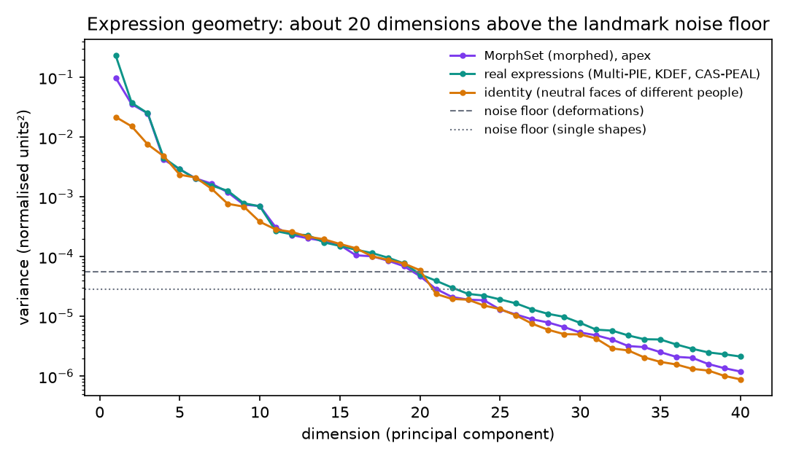
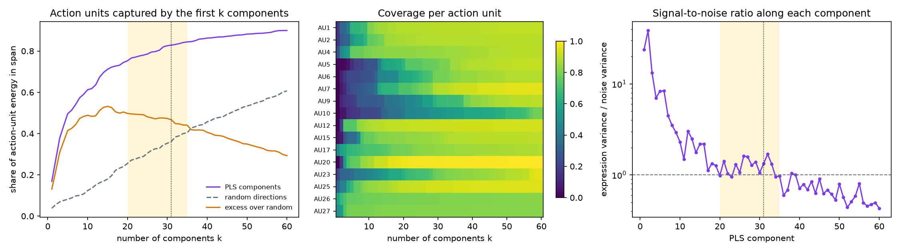
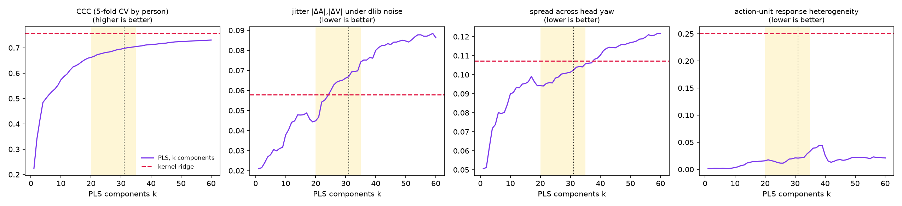
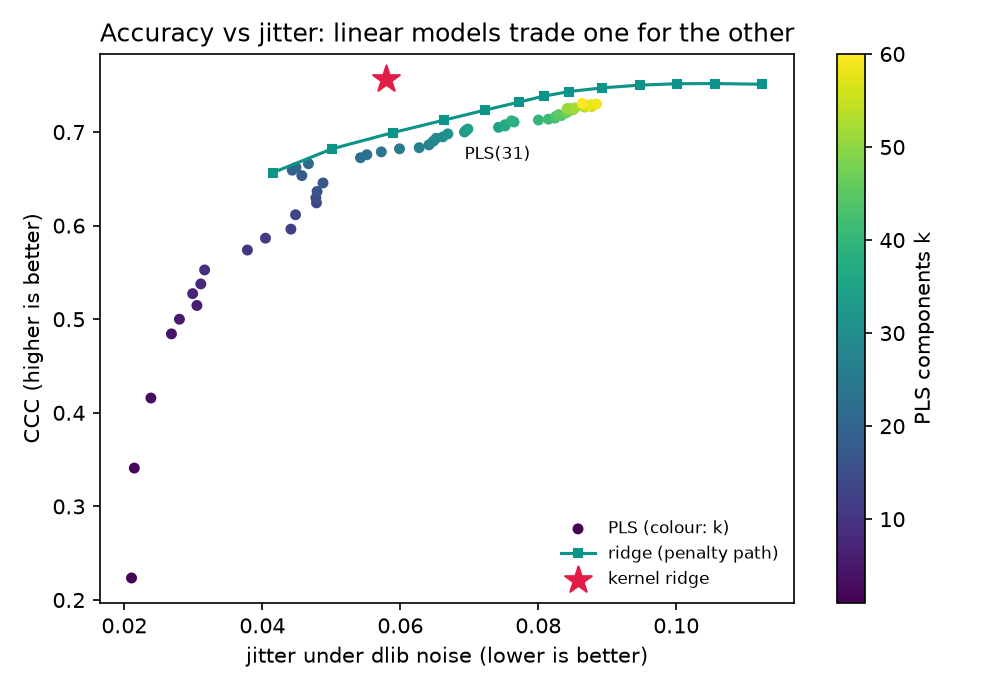

# Why a low-dimensional linear model wins in real time: expression dimensionality, action units and the live behaviour of geometric affect regression

*Vassilios Vonikakis. Analyses and draft prepared with Claude (Anthropic). Working paper, November 2026.*

**Reproduce:** every number and figure comes from `experiments/14_pls_dimensionality.py` (about
9 minutes on a laptop CPU), using the data and code of this repository.

---

## Abstract

A linear Partial Least Squares (PLS) regressor with 31 components, applied to pairwise distances
between 51 facial landmarks, estimates arousal, valence and intensity in real time. Two
observations motivated this study. First, 31 is close to the number of facial action units
(AUs) defined by the Facial Action Coding System (FACS). Second, in a live webcam demo the
31-component model behaves better than models that are more accurate in cross-validation,
including ridge regression and RBF kernel ridge regression.

We test both observations on 83,191 images of 337 people (MorphSet) and on real expressions of
1,202 people (Multi-PIE, KDEF, CAS-PEAL):

1. **About 20 dimensions.** Within-person expression deformations of the 51 landmarks have
   about 20 dimensions above the detector's noise floor, in both morphed and real expressions.
2. **Components 1–20 are action units.** The first 10 PLS components each match an AU template
   (jaw drop, lip-corner puller, brow lowerer, chin raiser…), and 8 of the next 10 do. Beyond
   component 20, matches fall to the level of random directions. Small, low-variance AUs (lid
   raiser, cheek raiser, lid tightener) are only covered by components 20–31.
3. **Signal-to-noise crosses 1 near component 20.** Along each component, expression variance
   falls to the landmark-noise variance at component 20 and stays near it until about 35–39.
   Replicability across people falls in step.
4. **Offline accuracy and live behaviour pull apart.** Cross-validated accuracy rises steadily
   with complexity. Jitter under realistic landmark noise and sensitivity to head pose rise with
   it. The kernel model's response to the same synthetic AU varies about 12 times more across
   faces than a linear model's, and its neutral faces vary more across people.
5. **The good behaviour is not specific to PLS.** A ridge regression regularised to a comparable
   effective complexity matches or beats PLS(31) on every measure.

We conclude that the "coincidence" reflects a single fact: through 51 landmarks and a detector
with about 1 px of noise, the face resolves roughly 20–35 independent movement patterns, about
the number of landmark-visible action units. Offline metrics average out per-face noise and
reward fitting dimensions beyond that. Live use, which judges one face frame by frame, penalises
exactly those dimensions. Model selection for interactive affect estimation should therefore
include behavioural criteria, not only accuracy.

---

## 1. Introduction

Geometric facial-expression models map facial landmarks to affect. In the system studied here,
dlib's 68-point landmarks (Kazemi & Sullivan, 2014) are normalised for position, scale and rotation, frontalized by a
linear map (Vonikakis & Winkler, 2020), and turned into 1,275 distances between the 51
non-jaw landmarks. These distances are divided by a scale measured on expression-stable points,
and a regressor predicts arousal, valence and intensity, the dimensions of Russell's circumplex
model of affect (Russell, 1980; Vonikakis & Winkler, 2021). The
regressor is trained on MorphSet (Vonikakis et al., 2021), whose dimensional labels are generated
by morphing each person's neutral face towards their posed expressions.

The original 2021 system used PLS with 31 components. The choice was not made by
cross-validation. It was the author's: roughly the number of facial action units, and the model
that behaved best in a live demo. A modern evaluation of the same system
(`experiments/06`, `08`, `12`) found that:

- nested cross-validation prefers about 50 components;
- ridge and RBF kernel ridge regression are more accurate in person-grouped cross-validation and
  when generalising to a held-out database;
- PLS(31) nevertheless behaves better on new faces: neutral faces land nearer the origin, a
  synthetic smile moves along the valence axis, and outputs vary less across head pose.

This paper asks why. Specifically:

- **Q1.** How many independent dimensions does facial expression have, as seen through these
  landmarks?
- **Q2.** Do PLS components correspond to action units, and up to which component?
- **Q3.** What property of models of different complexity explains their live behaviour, and
  why does offline accuracy not capture it?

## 2. Data and methods

### 2.1 Data

- **MorphSet** (Vonikakis et al., 2021): 83,191 images of 337 people from RaFD, KDEF, WSEFEP
  and FACES, with dlib landmarks. Each person's neutral face is morphed in 10 steps towards 7
  basic expressions and 4 blends. MorphSet's subject ids identify photo series, not people, so
  all splits here use corrected person ids (`facial_expression_analysis.training.data`). We use
  the original images only and drop the mirrored copies.
- **Real expressions:** the multi-pose landmark dataset used to train the frontalizer. It covers
  Multi-PIE, KDEF and, most likely, CAS-PEAL, with 42,834 shapes of 1,202 people. For
  dimensionality we use frontal views (2,323 expressions with a neutral of the same person). For
  behaviour we use Multi-PIE and CAS-PEAL people only, because KDEF people are also in MorphSet:
  2,294 neutral frontal faces and 23,795 faces at yaw ≤ 45°.
- **Detector noise.** MorphSet contains a horizontally mirrored copy of every image, whose
  landmarks dlib detected independently. After frontalization and undoing the mirror, the
  difference between twins measures dlib's repeatability. It is 0.0053 normalised units per
  coordinate (≈ 0.8 px at a 150 px eye distance).

### 2.2 Action-unit templates

Without AU-annotated landmark data, we wrote geometric templates for 16 AUs that move the 51
landmarks: AU1, 2, 4, 5, 6, 7, 9, 10, 12, 15, 17, 20, 23, 25, 26 and 27. Each is a symmetric,
unit-norm displacement field derived from the FACS description (Ekman, Friesen & Hager, 2002).
Examples: AU12 moves the lip corners up and outwards; AU5 raises the upper eyelids. The templates
encode direction, not magnitude
(`facial_expression_analysis.training.action_units`).

### 2.3 Measures

- **Intrinsic dimension.** The number of principal components of a set of shape deformations
  whose variance exceeds the noise floor. The floor is the measured noise variance for single
  shapes, and twice that for deformations, which are differences of two detections.
- **Component movement.** For a PLS component's loading vector in distance space, the
  minimum-norm landmark displacement that produces it, by least squares through the Jacobian of
  the distances.
- **AU match.** The absolute cosine between a component's movement and the best AU template.
  The null distribution comes from 300 random feature-space directions; we use its 95th
  percentile (0.31).
- **AU coverage.** The share of each template's energy that lies in the span of the first *k*
  component movements, compared with the span of *k* random directions.
- **Localisation.** One minus the normalised entropy of a movement's energy over facial regions.
  A component counts as localised above the random-direction 95th percentile.
- **Replicability.** PLS is fitted on two disjoint halves of the people. For each component of
  one fit, we take the best absolute cosine with any component of the other fit, averaged over
  two splits. We also report subspace stability, the mean squared cosine of the principal angles
  between the spans of the first *k* components.
- **Identity share.** For each component's scores, the variance across people's neutral faces
  divided by that variance plus the variance of within-person expression deformations.
- **Signal-to-noise ratio (SNR).** The variance of within-person expression deformations
  projected on a component, divided by the variance that dlib-like landmark noise produces in
  the same direction. The noise is 1 px per coordinate at a 150 px eye distance, added to the
  raw landmarks before frontalization.
- **Accuracy.** Concordance correlation coefficient (CCC; Lin, 1989) in 5-fold cross-validation
  grouped by person, averaged over arousal, valence and intensity. *Delta CCC* is computed on
  responses relative to the person's own neutral face.
- **Live-behaviour measures,** on unseen Multi-PIE and CAS-PEAL people. Models are trained on
  all of MorphSet.
  - *Identity leakage:* the standard deviation of (A, V) across the neutral faces of different
    people.
  - *AU response heterogeneity:* each AU template, at 6% of the eye distance, is applied to
    every neutral face. The measure is the share of the variance of the resulting (A, V) changes
    that differs between faces: 0 means an identical response for everyone.
  - *Jitter:* the mean |ΔA|, |ΔV| under the landmark noise described above.
  - *Pose sensitivity:* the standard deviation of (A, V) across yaw for the same person and
    expression.

### 2.4 Models

- **PLS** (Wold, Sjöström & Eriksson, 2001): *k* = 1–60 components, standardised features.
- **Ridge:** 13 penalties from 10⁻⁷ to 10⁻¹ per sample, standardised features. Effective
  degrees of freedom: Σλᵢ/(λᵢ + αn).
- **RBF kernel ridge:** a Nyström basis of 2,000 faces, γ = 0.5/1,275, α = 1, chosen by nested
  CV in `experiments/08`.

## 3. Results

### 3.1 Expression geometry has about 20 dimensions above the noise floor

*Figure 1. Variance of the principal components of within-person expression deformations
(MorphSet, purple; real expressions, green) and of identity (neutral faces of different people,
orange), against the detector-noise floor.*

| Deformations | n | Dims for 95% variance | 99% | Above noise floor |
|---|---|---|---|---|
| MorphSet expressions (apex) | 8,248 | 5 | 10 | **19** |
| Real expressions (frontal) | 2,323 | 3 | 9 | **19** |
| Identity (neutral faces) | 711 | 8 | 16 | 20 |

Three or four movements (mouth opening, smile, brow movement) carry most of the variance, but
about 20 directions are measurably above the detector's noise.

Morphed and real expressions give the same count. So the dimension is a property of faces as
seen through 51 landmarks, not an artefact of morphing (which interpolates landmarks linearly).

Notably, the identity spectrum lies almost on top of the expression spectra from dimension 4 to
20. People's resting faces differ along as many directions, and by as much, as their expressions
do. A regressor must therefore separate two signals of similar size and dimension.

### 3.2 The first ~20 PLS components are action units

*Figure 2. Facial movement encoded by the first eight PLS components (arrows), with the
best-matching action-unit template.*

The leading components are recognisable action units:

| Component | Best AU | Cosine |
|---|---|---|
| 1 | AU26 jaw drop | 0.76 |
| 3 | AU12 lip-corner puller | 0.80 |
| 4 | AU27 mouth stretch | 0.62 |
| 5 | AU4 brow lowerer | 0.79 |
| 7 | AU17 chin raiser | 0.60 |

The random-direction 95th percentile is 0.31.

| Components | Match an AU (> null 95%) | Localised | Replicability | Median SNR |
|---|---|---|---|---|
| 1–10 | 10/10 | 8/10 | 0.90 | 7.7 |
| 11–20 | 8/10 | 4/10 | 0.84 | 1.6 |
| 21–31 | 2/11 | 5/11 | 0.66 | 1.3 |
| 32–45 | 1/14 | 3/14 | 0.57 | 0.87 |
| 46–60 | 0/15 | 5/15 | 0.47 | 0.53 |

*Figure 3. Left: share of 16 AU templates captured by the first k components (purple), by k
random directions (grey), and the difference (orange). Middle: coverage per AU. Right: SNR along
each component. Shaded: components 20–35; dotted: k = 31.*

The span of the first *k* components captures far more of the AU templates than random
directions do:

| k | 10 | 20 | 31 | 40 | 60 |
|---|---|---|---|---|---|
| PLS | 0.61 | 0.75 | 0.83 | 0.86 | 0.90 |
| Random | 0.12 | 0.26 | 0.36 | 0.46 | 0.61 |
| Excess | 0.49 | 0.50 | 0.47 | 0.41 | 0.29 |

The excess peaks at 0.53 around *k* = 15 and declines steadily after about 30. Further components
add no more AU structure than random directions.

Coverage per AU (middle panel) shows the order in which AUs are learnt:

- **Large mouth and brow movements first.** AU12, AU20, AU25, AU1, AU2 and AU4 reach 75–88%
  within 10 components.
- **Eyelid AUs late.** AU5 upper lid raiser (0.27 at *k* = 10 → 0.65 at 20 → 0.80 at 31), AU6
  cheek raiser (0.25 → 0.60 → 0.79) and AU7 lid tightener (0.31 → 0.72 → 0.88) are only covered
  by components 20–31. Their landmark displacements are a few pixels, close to the noise.
- **Two AUs remain poorly covered** even at *k* = 31: AU9 nose wrinkler (0.67) and AU10 upper lip
  raiser (0.53). Their landmark signature is small and overlaps with neighbouring AUs.

*Figure 4. Per-component replicability across disjoint halves of the people, identity share of
the score variance, and components localised like an AU.*

Components 5–20 have an identity share of 0.55–0.72: their scores vary more between people's
neutral faces than with expression. These are directions where identity and expression overlap,
such as brow height. PLS must model them to separate the two. Replicability drops from about
0.88 to about 0.68 between components 18 and 22. The subspace spanned by the first *k* components
stays stable (mean squared cosine 0.94 at *k* = 20, 0.91 at 31, 0.86 at 60). So late components
are individually unstable even though the space they add to is not arbitrary.

### 3.3 The signal-to-noise ratio crosses 1 near component 20

Along the first components, expression variance exceeds landmark-noise variance by a factor of
7–39. The SNR falls below 2 at component 11 and reaches 1 at component 20 (right panel of
Figure 3). It then fluctuates around 1 (0.95–1.7) until about component 35, and stays below 1
after component 39.

This matches the intrinsic dimension of §3.1 (about 19–20 directions above twice the noise
variance). It also matches the point where AU matches and replicability end (§3.2). Components
20–35 encode real but small movements, such as the eyelid AUs, at an SNR near 1. Beyond that,
components are dominated by noise.

### 3.4 Accuracy vs live behaviour

*Figure 5. As the number of PLS components grows (purple), CCC rises steadily, but jitter and
pose sensitivity rise with it. Kernel ridge (red, dashed) is the most accurate, but its response
to action units depends on the face.*

| Model | CCC | Delta CCC | Identity leakage | AU heterogeneity | Jitter | Pose sensitivity |
|---|---|---|---|---|---|---|
| PLS(10) | 0.574 | 0.428 | 0.143 | 0.003 | 0.038 | 0.090 |
| PLS(20) | 0.662 | 0.523 | 0.144 | 0.016 | 0.045 | 0.094 |
| **PLS(31)** | 0.698 | 0.555 | 0.140 | 0.021 | 0.067 | 0.102 |
| PLS(50) | 0.725 | 0.580 | 0.145 | 0.022 | 0.085 | 0.117 |
| Ridge, α = 3·10⁻³ (104 df) | 0.713 | 0.564 | **0.133** | 0.023 | 0.066 | **0.099** |
| Ridge, α = 10⁻⁷ (668 df) | 0.751 | 0.617 | 0.189 | 0.053 | 0.112 | 0.146 |
| Kernel ridge | **0.757** | 0.615 | 0.176 | **0.251** | 0.058 | 0.107 |

**Accuracy rises with complexity.** For PLS, CCC goes from 0.57 (*k* = 10) to 0.70 (31) and 0.73
(60). Lightly penalised ridge and kernel ridge reach 0.75–0.76. This is the offline result that
favours complex models.

**Linear models: complexity costs jitter and pose stability.**
- *Jitter:* PLS rises from 0.038 (*k* = 10) to 0.067 (31) and 0.086 (60). For ridge it ranges
  from 0.042 to 0.112.
- *Pose sensitivity:* PLS rises from 0.090 to 0.102 and 0.122.

Both follow from §3.3. Components with an SNR near or below 1 add as much landmark noise as
signal to every prediction, and pose-induced shape changes that frontalization leaves behind
project onto them as well.

**Kernel ridge: a different failure.** Its jitter (0.058) is moderate, below PLS(31). Its weakness
is equivariance. The same synthetic AU changes its output differently on different faces:
heterogeneity is 0.25, against 0.02 for linear models. Its predictions for neutral faces also
vary more between people (0.176 vs 0.140). This quantifies the "bending smile" seen in the live
demo and in `experiments/12`.

A linear model in distance space responds to a movement almost identically on every face. The
small heterogeneity of linear models comes from the non-linearity of distances. A kernel model's
response depends on how close a face is to its training faces.

**The kernel's offline gain is not identity fitting.** Its advantage also holds for within-person
responses (delta CCC 0.615 vs 0.555 for PLS(31)), so it is not explained by fitting
person-specific offsets. On MorphSet the kernel model is genuinely more accurate. The question is
what it does on faces and conditions unlike its training data.

*Figure 6. Accuracy against jitter. Along the ridge penalty path (teal) and the PLS component path
(coloured by k), accuracy is bought with jitter. Ridge lies slightly above PLS. Kernel ridge (star)
is off this frontier: accurate and moderately stable, but not equivariant.*

**PLS is not special.** At equal jitter, the ridge path is slightly more accurate than the PLS
path. Ridge with α = 3·10⁻³ matches PLS(31)'s jitter (0.066 vs 0.067), with higher CCC (0.713 vs
0.698), lower identity leakage (0.133 vs 0.140), lower pose sensitivity (0.099 vs 0.102) and similar
heterogeneity. Its effective degrees of freedom (104) exceed 31. PLS's own degrees of freedom are
known to exceed its number of components (Krämer & Sugiyama, 2011), and PLS and ridge are known to
shrink similarly (Frank & Friedman, 1993). What matters is the effective complexity of a
regularised linear model, not the PLS algorithm.

## 4. Discussion

### 4.1 Why offline accuracy and live behaviour disagree

Cross-validated CCC is computed over tens of thousands of faces. A direction whose SNR is below 1
for a single face can still carry signal that is consistent across the population, and the
average error falls when the model uses it. The MSE-optimal model therefore keeps adding
dimensions well past the point where they are reliable for an individual face.

A user watching the live demo does not see a population average. They see:

- **one face, frame by frame,** where per-frame noise in those directions appears as jitter;
- **their own neutral face,** where identity leakage appears as a personal offset;
- **their own movements,** where non-equivariance appears as trajectories that bend.

These are variance and consistency errors at the level of the individual. Offline metrics weight
them weakly, or not at all. An interactive system is judged on a different loss, and that loss
favours models whose complexity stops near the number of dimensions with SNR ≳ 1. Here that is
about 20–35 components, or an equivalent ridge penalty. PLS(31) sits at the upper end of that
range: it includes the eyelid AUs at SNR ≈ 1 and little beyond.

Temporal smoothing reduces jitter, but at the cost of lag. A model that jitters less can use less
smoothing and react faster.

### 4.2 The "coincidence" with action units

FACS defines 44 action units, of which about 30 correspond to contractions of specific facial
muscles: 12 in the upper face and 18 in the lower face (Tian, Kanade & Cohn, 2001). Not all of
them move the 51 landmarks used here. For example, AU11 (nasolabial deepener) and AU14 (dimpler)
leave the landmarks almost unchanged. By our estimate, roughly 20–25 are landmark-visible.

The measured dimensions are of the same order:

- about 19–20 directions of expression above the noise floor;
- AU-aligned PLS components up to about 20;
- an SNR plateau near 1 up to about 35.

We therefore read the coincidence as two descriptions of one quantity: **the number of
independent movement patterns the face can produce that the landmark detector resolves above its
noise.** Anatomy sets the number of independently controllable movements (FACS counts them as
action units). Detector noise sets how many of them, and how small, are measurable. A
variance-driven latent method such as PLS discovers them in order of amplitude and runs out of
reliable ones at about this count.

Two caveats keep this from being a precise equality:

- **Counting is resolution-dependent.** Lower landmark noise would reveal more dimensions, such as
  finer eyelid and nose movements and asymmetric (unilateral) AUs.
- **Rotation.** PLS components are not individually identifiable with AUs beyond the first few.
  Later components mix several AUs and identity, as the falling AU matches and the high identity
  share of components 5–20 show.

### 4.3 Implications

1. **Select models for interactive affect estimation with behavioural tests alongside accuracy.**
   Useful tests are jitter under realistic landmark noise, identity leakage on neutral faces,
   equivariance to synthetic action units, and pose sensitivity. All of them can be computed
   without new labels.
2. **Choose the regularisation from the noise.** The SNR along latent directions, measured with a
   noise model of the landmark detector (here from mirrored re-detections), predicts where extra
   components stop paying off live.
3. **Prefer linear models in landmark-distance space when consistency matters.** They respond to
   a facial movement the same way on every face.

### 4.4 Limitations

- **AU templates are hand-made.** They are geometric approximations from FACS descriptions. A
  test against AU-annotated landmark data (CK+, Lucey et al., 2010; DISFA, Mavadati et al.,
  2013) would make the AU correspondence firmer.
- **Synthetic labels.** MorphSet's labels are morph interpolations of posed prototypes, and the
  dimensionality of spontaneous expressions may differ. The real-expression data (posed, but not
  morphed) gave the same count.
- **Noise model.** It is isotropic and Gaussian, estimated from mirrored re-detections on
  well-lit posed photos. Webcam noise, especially in low light, is larger and structured, which
  would lower the reliable dimension further.
- **One detector and one landmark set.** The counts are specific to dlib's 68 points and the 51
  non-jaw landmarks. A denser landmark set (e.g. MediaPipe's 478 points) could resolve more AUs.
- **Live quality is proxied, not measured with users.** The behavioural measures are proxies for
  the author's live observations. A user study would test the link directly.
- **Degrees of freedom of PLS** are not computed here. The ridge comparison is made at matched
  behaviour, not matched degrees of freedom.

## 5. Conclusion

Through 51 landmarks and a detector with about 1 px of noise, facial expression has about 20
independent dimensions, and a few more at the noise level. The leading PLS components recover
action units in order of amplitude. After about 20 components, AU structure, replicability and
signal-to-noise all fade, and by about 35 noise dominates.

Offline accuracy keeps improving beyond that point because it averages over many faces. Live
behaviour, judged one face at a time, gets worse: more jitter, more pose sensitivity, and for the
kernel model, responses that depend on the face.

A regularised linear model with an effective complexity near the reliable dimension of the face
gives the best live behaviour. PLS(31) is one such model, chosen in 2021 by intuition. The number
of action units turns out to be a reasonable proxy for the number of facial movements a landmark
tracker can resolve.

## References

- Ekman, P., Friesen, W. V., & Hager, J. C. (2002). *Facial Action Coding System: The Manual.*
  Research Nexus.
- Frank, I. E., & Friedman, J. H. (1993). A statistical view of some chemometrics regression
  tools. *Technometrics*, 35(2), 109–135.
- Kazemi, V., & Sullivan, J. (2014). One millisecond face alignment with an ensemble of
  regression trees. *CVPR*.
- Krämer, N., & Sugiyama, M. (2011). The degrees of freedom of partial least squares regression.
  *Journal of the American Statistical Association*, 106(494), 697–705.
- Lin, L. I.-K. (1989). A concordance correlation coefficient to evaluate reproducibility.
  *Biometrics*, 45(1), 255–268.
- Lucey, P., Cohn, J. F., Kanade, T., Saragih, J., Ambadar, Z., & Matthews, I. (2010). The
  extended Cohn-Kanade dataset (CK+). *CVPR Workshops*.
- Mavadati, S. M., Mahoor, M. H., Bartlett, K., Trinh, P., & Cohn, J. F. (2013). DISFA: a
  spontaneous facial action intensity database. *IEEE Transactions on Affective Computing*, 4(2),
  151–160.
- Russell, J. A. (1980). A circumplex model of affect. *Journal of Personality and Social
  Psychology*, 39(6), 1161–1178.
- Tian, Y.-L., Kanade, T., & Cohn, J. F. (2001). Recognizing action units for facial expression
  analysis. *IEEE Transactions on Pattern Analysis and Machine Intelligence*, 23(2), 97–115.
- Vonikakis, V., & Winkler, S. (2020). Identity-invariant facial landmark frontalization for
  facial expression analysis. *ICIP*.
- Vonikakis, V., & Winkler, S. (2021). Efficient facial expression analysis for dimensional
  affect recognition using geometric features. arXiv:2106.07817.
- Vonikakis, V., Neo, D. Y. R., & Winkler, S. (2021). MorphSet: Augmenting categorical emotion
  datasets with dimensional affect labels using face morphing. *ICIP*.
- Wold, S., Sjöström, M., & Eriksson, L. (2001). PLS-regression: a basic tool of chemometrics.
  *Chemometrics and Intelligent Laboratory Systems*, 58(2), 109–130.
